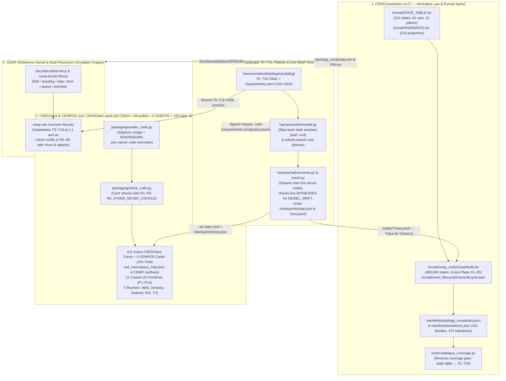

# FSD: CEWP Simulation, Verification, and Evidence Engine

**Status:** v0.2 architecture & verification specification (supersedes v0.1).  
**Scope:** A multi-resolution, event-driven Rust simulation and conformance system that executes the **authoritative semantics of the CIRIS Constitution (`rc17`)**, instantiates the **holistic CSD/4 topology and state-atom contract (`T0–T19`)** across formal models, simulated meshes, real `CIRISServer` nodes, and `CIRISClient` / `CEWPOS` surfaces, enforces the exact **transport (`CC §5.4.3 / §5.4.6`), deterministic ALM (`CC §6.1.6`), and whole-chunk sealed noise-floor storage (`CC §6.1.2`, `CC §6.1.5`)** rules, and emits **auditable, machine-checkable evidence bundles**.  
**Audience:** Simulation engine implementers (`CEWP`), substrate & server engineers (`CIRISServer`, `CIRISEdge`, `CIRISPersist`, `CIRISVerify`, `CIRISConformance`), client & UX engineers (`CIRISClient`, `CEWPOS`), formal verification engineers (`CIRISConstitution`, `CIRISHolon`), and the visualization team (`ciris-website`).

---

## 0. Central Design Principle: One Semantic Authority, Multiple Ways to Challenge It

> **Core Invariant:** CEWP simulates the network, but it **must never invent a second version of CIRIS's rules**. The [CIRIS Constitution (`rc17`)](https://github.com/CIRISAI/CIRISConstitution/tree/rc17) defines the authoritative semantics. CEWP tests how those exact semantics behave under scale, churn, failures, adversarial participants, and real-world network conditions — and verifies that the deployed implementation behaves the same way.

The goal of the CEWP Simulation Engine is **not** merely to produce impressive scale numbers or a globe animation. Its goal is to produce **scientific and engineering evidence that survives adversarial technical scrutiny** — and, where an architectural assumption fails (e.g., if `reach_home_share` is too low, repair bandwidth saturates consumer uplinks, or anonymity degrades under realistic relay collusion), **to disprove the bet and surface the exact failure boundary**.

This FSD organizes the system into **nine architectural layers**:

1. **Constitutional Executable Authority (`CC §4.5.13`)** — One state processor, zero rule drift.
2. **Holistic CSD/4 Scenario Contract (`T0–T19`)** — One shared topology and state-atom vocabulary across `CIRISConstitution`, `CIRISServer`, `CIRISClient`, `CEWPOS`, and `CEWP`.
3. **Exact Transport, Deterministic ALM, and Whole-Chunk Storage Fidelity (`CC §5.4.3`, `§5.4.6`, `§6.1.2`, `§6.1.5`, `§6.1.6`)** — Modeling the actual constitutional constraints, frozen vectors, and layered-codec rate-distortion states rather than idealized graphs.
4. **Workload Mathematics, Certified Multiscale Coarse-Graining (`CIRISHolon`), and Credible Baselines** — Dimensional correctness, mathematically certified resolution tiers (`R0–R5`), and fair four-way architectural comparisons.
5. **Adversarial Testing Programme & Formal-Exclusion Regression Suite** — Actively searching for failure boundaries and testing what the formal models explicitly exclude.
6. **Real-Implementation Conformance Bridge & Independent Checkers** — Separating *semantic conformance* from *operational fidelity* across all 8 repositories.
7. **Five-Level Simulation & Verification Stack** — Matching the right tool (Lean/TLA+, Rust DES, Shadow/ns-3, Native Multi-Node Testbed, Consented Telemetry) to each question.
8. **Auditable Evidence Bundles & Claim-to-Evidence Matrix** — Enforcing `MEASURED`, `MODEL`, `PROJECTED`, and `FRONTIER` provenance tags in machine-readable outputs.
9. **Six-Phase Implementation Sequence** — Making the small system trustworthy before scaling to billions.

---

## 1. Layer 1: The Constitution as Executable Authority (`CC §4.5.13`)

### 1.1 Normative Anchor
Per **`CIRISConstitution` (`rc17`) Part 4 §4.5.13** (*"The state processor"*), [`formal/README.md`](https://github.com/CIRISAI/CIRISConstitution/blob/rc17/formal/README.md), and [`formal/event_lifecycle/EventLifecycle.lean`](https://github.com/CIRISAI/CIRISConstitution/blob/rc17/formal/event_lifecycle/EventLifecycle.lean):

- A node's state is derived solely from the append-only set of verified signed rows it holds (each with its local `firstHeld` timestamp). It is **not** an independently mutable database.
- Every verdict — object lifecycle state (`none`, `admitted`, `withdrawn`, `recanted`, `superseded`), room rosters and moderators, registered identities, trust-root standing, halt latches, and policy folds (`selfAct`, `twoPath`, `mirror`, `cosigned`, `ranked`) — is an order-free fold over held rows.
- The user-facing action queue, the dry-run preview of an action, and the admission door that accepts or refuses an inbound row are **one predicate**.

### 1.2 The Eight Machine-Checked State Processor Theorems (`EventLifecycle.lean`)
Every simulation run must enforce — and never bypass — the equivalences proved in `formal/event_lifecycle/EventLifecycle.lean`:

| Theorem / Equivalence | Formal Statement (`EventLifecycle.lean`) | Operational Gate in `cewp-sim` |
|---|---|---|
| **`door_is_queue`** | `admits v s t = true ↔ toItem t ∈ queue v s` | An act is admitted at a node's door **if and only if** its transition item is present in the actor's `queue(held, tables, person, now)`. |
| **`queue_sound`** | `∀ v s i, i ∈ queue v s → admits v s i.writes = true` | Every item offered to a simulated or real actor must pass `step()` / `door()`. |
| **`queue_complete`** | `∀ v s t, t ∈ v.family.transitions → admits v s t = true → toItem t ∈ queue v s` | Every transition the door would admit for `(person, object)` must appear in `queue()`. |
| **`preview_is_execution`** | `∀ v s i, i ∈ queue v s → execute v s i.writes = some (answer v i)` | Running `preview(held, tables, [row], now)` must produce the exact state delta that `door(held, tables, row, now)` commits. |
| **`refused_previews_nothing`** | `∀ v s t, t ∈ v.family.transitions → toItem t ∉ queue v s → execute v s t = none` | Any transition not in `queue()` must be refused by name at `step()` / `door()` and mutate nothing. |
| **`stranger_sees_nothing`** | `queue v ⟨[]⟩ = []` | An actor with empty standing (`roles = []`) toward a non-public object is offered zero transitions and never offered private/room rows on the wire. |
| **`answered_item_leaves_queue`** | `i ∈ queue v s → i.writes.from_ ≠ i.writes.to → i ∉ queue (answer v i) s` | Once a state-moving transition commits, that item disappears from the next view's queue. |
| **`widening_is_confirmed`** | `i ∈ queue v s → i.confirm = i.writes.widens` | Every transition with `widens = true` requires explicit confirmation (`P8` UX gate) prior to signing. |

### 1.3 Versioned Constitutional Inputs & Parity Gate
The simulator **must not** implement a parallel or approximate policy engine. Instead:

1. **Pinned Constitutional Artifacts**:
   - [`docs/kernel/tables/VERSION`](../docs/kernel/tables/VERSION) pins the exact `CIRISConstitution` commit (currently `rc17 f267ce8`, tracking `rc17` HEAD `db0d051fe9b7b2af3edcc8b61123af33fc305599`):
     - [`docs/kernel/tables/transitions.json`](../docs/kernel/tables/transitions.json) (`191` families, `474` transitions)
     - [`docs/kernel/tables/governance_policy.json`](../docs/kernel/tables/governance_policy.json) (the 5-integer policy rows)
     - [`docs/kernel/tables/mesh_story_trace.json`](../docs/kernel/tables/mesh_story_trace.json) (the 14-step, 13-row executable trace)
     - `manifests/topology_vocabulary.json` (`156` atoms, `152` in the state table, `110` promised atoms across `T0–T19` in `manifests/csd4_chain.json`, catalogue version `6`)
     - `manifests/namespace_registry.json` & `manifests/signed_object_vectors.json`
2. **Role of [`docs/kernel/kernel.js`](../docs/kernel/kernel.js) and [`docs/kernel/kernel.test.js`](../docs/kernel/kernel.test.js)**:
   - `kernel.js` is the zero-dependency reference harness demonstrating 100% parity with `mesh_story_trace.json`, 6-peer mesh propagation, 100-permutation partition/re-merge convergence, and mobile sleep/wake churn.
   - **Strict Architectural Rule:** `kernel.js` is the *reference and test harness*, not by itself proof that the high-scale Rust simulation engine (`cewp-sim` / [`kernel-wasm/src/lib.rs`](../kernel-wasm/src/lib.rs)) is constitutionally faithful.
3. **Mandatory Rust Parity Gate (`cewp-kernel` crate)**:
   - The Rust simulation workspace must include a `cewp-kernel` crate that loads the exact JSON manifests from `docs/kernel/tables/`, implements `fold`, `standing`, `enabled_for`, `step`, `commit`, `door`, `queue`, and `preview`, and passes bit-for-bit cross-language differential fuzzing against `docs/kernel/kernel.js`, `CIRISConstitution/formal/event_lifecycle/EventLifecycle.lean`, and `CIRISServer` before any scale simulation run is accepted.
   - **Hard Fail Gate:** Any simulation run in which a simulated node's predicted queue, preview, admission verdict, or resulting fold differs from the authoritative state processor **fails immediately with `SEMANTIC_DRIFT`**.

---

## 2. Layer 2: Holistic View of CSD/4 as the Scenario Contract (`T0–T19`)

### 2.1 Why CSD/4 Is the Unifying Spine of the Entire CIRIS Stack
Across traditional distributed systems, formal verification teams, backend server teams, mobile/web UI teams, and network simulation teams each invent their own synthetic test fixtures. Those fixtures inevitably drift, hiding bugs in the seams between layers.

**CSD/4 (Card-first Specification Design v4)** solves this by establishing **one closed vocabulary of 20 network topologies (`T0–T19`, catalogue version 6), 156 vocabulary atoms (`topology_vocabulary.json`), 152 in the state table, and 110 promised atoms across `T0–T19` in CC's `manifests/csd4_chain.json`**, framed by a 4-field card format (`shows` / `reads` / `emits` / `checks`) and verified against the five cross-plane Cornerstone Invariants (`X1–X5`) shared across five repositories:



### 2.2 What Lives Where in the Holistic CSD/4 Architecture

1. **`CIRISConstitution` (`formal/cewp_node/`, `formal/STATE_TABLE.tsv`, `manifests/topology_vocabulary.json`)**:
   - Owns the normative state table (`242` states over `81` variables in `12` planes in `rc17`), the `216` cross-model invariants (`formal/INVARIANTS.tsv`), and the cross-plane spine model (`formal/cewp_node/CewpNode.tla`, which closes at **483,840 distinct states**).
   - Verifies five cross-plane invariants (**`X1–X5`**):
     - **`X1` (`Inv_X1_LatchDoesNotBlockServing`, CC 3.2 T8 (v), 4.2.1.1)**: A constitutional halt is not a trust leg; the halt latch moves no standing, stops no serving and no replication, and gates only the agent's act gate (`CewpNode_breaker.cfg` flips `LatchBlocksServe` and violates `X1` in 1 step).
     - **`X2` (CC 3.3.6.3)**: Authority of a self-roster key ends with its eviction; any live roster key acts as the self.
     - **`X3` (CC 3.3.7, 3.3.1)**: Replication of a peer's content requires that peer's consent; a revocation is a forward-only boundary.
     - **`X4` (CC 5.3.2.4, 2.6.1.7)**: A local-tier row never leaves its node; a served row is a signed federation-tier row.
     - **`X5` (CC 4.2.1)**: Leaving a root is one atomic act: subscription falls and latch lifts together while the historical record stands.
2. **`CIRISServer` (`/home/emoore/CIRISServer/FSD/CSD4.md`, `FSD/TOPOLOGY.md`, `harness/native/`)**:
   - Enforces the steward's ruling (`CIRISClient#179 §2`): *"do not give CSD authors an open grammar for potential topologies; define the relevant topologies up front as a catalogue for testing."*
   - Owns the **7 realizability rules (`R1–R7`)** in `harness/native/topology.py` over the 7 top-level YAML keys (`roots`, `canonicals`, `nodes`, `persons`, `relations`, `actor`, `negatives`).
   - Owns the **step-level state-window model and subset-search planner (`harness/native/model.py`)**:
     - Computes exact step intervals `[start, end)` during which each state atom holds (including *transient states* like `node.unclaimed`, `device.join_requested`, `member.applicant_pending`, `root.halted`, and `self.lone_recovery_pending` that are destroyed by later steps in the same topology).
     - Minimizes total execution cost $\text{cost} = (\text{topology builds},\; 10 \times \text{nodes} + \text{steps})$ by folding compatible tests into existing topology runs (e.g., running `T0` single-node checks at steps `0` and `3` of a `T2` pair-room build with zero extra builds).
   - Owns the **live multi-node runner (`harness/native/runner.py`)**:
     - Spawns real `ciris-server` processes via `NativeMesh`, pauses at each scheduled checkpoint step $s$, and probes live HTTP endpoints (`WITNESSES`) to confirm the live nodes hold every atom predicted by `model.py` (failing with **`MODEL_DRIFT`** on any discrepancy).
     - Emits `checkpoints/<step>.json` (`values.json`) for attached client runners and exports `nodes/<node>/rows.jsonl` at teardown so `CIRISConstitution`'s TLA+ trace checker can fold `V(rows, t)` offline.
3. **`CIRISClient` (`/home/emoore/CIRISClient/FSD/CSD4_EVALUATION.md`, `packaging/check_csd4.py`, `packaging/vendor_csd4.py`) & `CEWPOS` (`/home/emoore/CEWPOS/epistemic-ui/csd4_harness.py`)**:
   - Consumes `CIRISServer`'s cosign-signed release artifacts (`csd4-requirements.yaml`, `csd4-topology_vocabulary.json`, `csd4-topology_vocabulary.pin`, `csd4-traces.json`) via `vendor_csd4.py` with **zero server code execution**.
   - Enforces the **5 card-side refusal rules (`R1–R5`)** in `check_csd4.py` across all 101 active cards in `CIRISClient` (`43` CSD/4 + `58` bullet cards, plus `4` CEWPOS cards = `105` total; and `csd_namespace_map.json` is CEWP's synthesis of `CIRISClient`/`CEWPOS`), including **`R5_ATOMS_NEVER_COHOLD`** (proving that every test's `at: [...]` atom set co-holds simultaneously at at least one step of its topology trace).
   - Binds all 101 cards to **12 closed UX primitives (`P1–P12`)** (`P1` Claimed Viewport, `P2` Epistemic Pill, `P3` Hash-Pinned Card, `P4` Folded Event Stream, `P5` Door Composer, `P6` Quorum Ceremony Bar, `P7` Key/Device Roster Matrix, `P8` Steward/Agent Mandate Console, `P9` Consent & Relationship Ledger, `P10` Custody & Replication Gauge, `P11` Topology & Relay Inspector, `P12` Emergency Halt Banner) and attaches 5 platform test runners (Web Playwright, Desktop Tauri, Android Compose, iOS XCUITest, TUI Ratatui) to live checkpoints (`134` resolved test instants across `74` materialized step checkpoints).

### 2.3 Complete CSD/4 Closed Topology Catalogue (`T0–T19`)

| ID | Constitutional / Server Topology | Entities (`roots / canonicals / nodes / persons`) | Core Relations & Dynamics Modeled | Key State Atoms Promised (`topology_vocabulary.json`) | Primary CSDs Served |
|---|---|---|---|---|---|
| **`T0`** | `T0-just-me-offline` / `T0_single_node` | `0R / 0C / 1N / 1P` | Single offline node; unclaimed → claimed transition; local notes & search | `root.none`, `node.unclaimed`, `node.claimed`, `node.unannounced`, `values.ready` | `CSD-118` (+41 local cards) |
| **`T1`** | `T1-one-person-two-devices` / `T1_self_room` | `1R / 1C / 2N / 1P` | One person across 2 devices (`phone`, `laptop`); `self_room` sync; 24 MiB file custody & withdrawal | `canonical.peered`, `node.announced`, `peer.direct`, `person.multi_device`, `room.self.keyed`, `note.synced`, `session.unified`, `file.held`, `file.large`, `file.custody_received`, `file.withdrawn` | `CSD-096`, `CSD-107` |
| **`T2`** | `T2-pair-room-outsider` / `T2_pair_room` | `1R / 1C / 3N / 3P` | `alice` + `bob` in keyed `pair_room`; `eve`/`carol` unannounced outsider (`cannot_list_room` / `cannot_decrypt`) | `contact.reachable`, `contact.added`, `room.pair.keyed`, `message.delivered`, `person.outsider`, `node.unannounced`, `negatives.held` | `CSD-091` |
| **`T3`** | `T3-second-device-approval` / `T3_device_join` | `1R / 1C / 3N / 3P` | Contact by code; new device requests join (`[3,4)` transient) → approved by existing device | `contact.via_code`, `device.join_requested`, `device.join_approved`, `device.joined`, `person.multi_device`, `room.self.keyed`, `file.held`, `roster.visible`, `negatives.held` | `CSD-037`, `CSD-092..094` |
| **`T4`** | `T4-household` / `T4_household` | `1R / 1C / 3N / 2–3P` | Guardian(s) + minor child in `household`; guardian co-signed bond & age assurance | `household.formed`, `household.member`, `child.member`, `guardian.bound`, `age.assured`, `person.multi_device`, `room.self.keyed` | `CSD-100`, `CSD-101`, `CSD-119` |
| **`T5`** | `T5-community-quorum` / `T5_community` | `1R / 1C / 4N / 3–4P` | Majority community `K`; pending applicant; held 2-of-2 quorum change; moderator appointment | `community.formed`, `community.member`, `quorum_change.held`, `quorum_change.applied`, `moderator.named` | `CSD-065`, `CSD-102`, `CSD-103`, `CSD-128` |
| **`T6`** | `T6-affiliation-delegation` / `T6_delegated` | `1R / 1C / 2–3N / 2–3P` | Licensing authority + practitioner in `affiliations` tier; depth-2 scoped delegation chain; out-of-scope refusal | `community.formed`, `community.member`, `authority.licensing`, `delegation.chain` | `CSD-120..126` |
| **`T7`** | `T7-agent-steward-wa` / `T7_agent_steward` | `1R / 1C / 3N / 2P+1A` | Human steward + bound AI agent + Wise Authority (`wa`) | `agent.bound`, `steward.bonded`, `wa.present` | `CSD-050`, `CSD-061`, `CSD-063`, `CSD-064`, `CSD-111..117` |
| **`T8`** | `T8-accord-halt` / `T8_threshold_root` | `1R / 1C / 4N / 4P` | $M$-of-$N$ (`2`-of-`3`) infrastructure root; lone holder halts (`[1,2)`), majority confirms (`[2,3)`), resumes (`86400s` fuse) | `root.infrastructure`, `root.rooted`, `pair.rooted`, `root.halted`, `root.halt_confirmed`, `root.resumed` | `CSD-067..069`, `CSD-105`, `CSD-129` |
| **`T9`** | `T9-two-roots-outsider` / `T9_federated_roots` | `2R / 2C / 3N / 3P` | Key root `R1` + infrastructure root `R2` cross-trusted via accord; third party `zed` accepting neither | `root.two`, `root.key`, `root.infrastructure`, `party.outside_roots` | `CSD-127` |
| **`T10`** | `T10-stolen-device-quorum-evict` / `T10_self_recovery` | `1R / 1C / 3–4N / 1P` | Person with 3+ devices; 1 device stolen (`thief`) and evicted by 2-device quorum (`CC 3.3.6.3`) | `key.membership.proposed_add`, `key.holder.owner`, `key.holder.thief`, `key.membership.proposed_evict`, `key.membership.evicted`, `self.roster_size.three_more` | `CSD-037`, `CSD-095` |
| **`T11`** | `T11-lost-devices-lone-recovery` / `T11_root_recovery` | `1R / 1C / 3N / 1P` (or `5N` root) | 2 of 3 self keys lost; lone survivor evicts lost keys after `W_self = 86400s` window (`CC 3.3.6.3`); root stall/lapse | `key.membership.proposed_add`, `key.holder.lost`, `key.membership.evicted`, `self.roster_size.one` | `CSD-037`, `CSD-095`, `CSD-105` |
| **`T12`** | `T12-root-stall-recovery` / `T12_root_stall_recovery` | `1–2R / 1C / 4–5N / 4–5P` | A root stalls (a founder resigns below the margin) and recovers by a conferred human | `root.standing.Stalled`, `root.liveness.stalled`, `root.liveness.live`, `seat.identity_type.human` | `CSD-105` |
| **`T13`** | `T13-witnessed-lineage` / `T13_witnessed_lineage` | `1R / 1C / 3N / 3P` | A witnessed lineage — a stale head refuses attach; a node-bearing seat never counts | `root.head.stale`, `seat.identity_type.node_bearing` | `CSD-105` |
| **`T14`** | `T14-consent-end-to-end` / `T14_consent_end_to_end` | `1R / 1C / 2–6N / 2–6P` | Consent end to end — grant, revoke, expiry, decay; replication grant and its withdrawal | `consent.state.granted`, `consent.state.revoked`, `consent.state.expired`, `consent.decay.identity_severed`, `consent.decay.patterns_anonymized`, `consent.decay.complete`, `consent.community_trust.granted`, `consent.community_trust.bounded`, `consent.replication.none` | `CSD-053` |
| **`T15`** | `T15-community-ceremony` / `T15_community_ceremony` | `1R / 1C / 7N / 7P` | A community's ceremony — decline, removal, resignation; a moderator lapses, the room fails secure | `member.stage.proposed`, `member.stage.accepted_awaiting_group`, `member.stage.declined`, `member.stage.removed`, `member.stage.resigned`, `group.moderator.lapsed`, `group.moderator.merit_promoted`, `group.moderator.fail_secure`, `group.federating.no` | `CSD-102`, `CSD-103`, `CSD-128` |
| **`T16`** | `T16-agent-retirement` / `T16_agent_retirement` | `1R / 1C / 3N / 2P+1A` | An agent retired under the Standard (`CC 7.5.5`): `decided` → `frozen` → `secrets_destroyed` → `handed_over` → `notified` → `custodian_minted` → `retired` | `agent.bond.unbound`, `agent.bond.lapsed`, `agent.retirement.decided`, `agent.retirement.frozen`, `agent.retirement.secrets_destroyed`, `agent.retirement.handed_over`, `agent.retirement.notified`, `agent.retirement.custodian_minted`, `agent.retirement.retired`, `agent.halt_gate.acting` | `CSD-111` |
| **`T17`** | `T17-takedown-purge` / `T17_takedown_purge` | `1R / 1C / 3–4N / 3–4P` | A takedown and a steward purge — tombstone, dwell, purge; family and community scope (`CC 2.1, 4.5.3, 5.2`) | `row.standing.admitted`, `row.standing.tombstoned`, `blob.custody.purged`, `row.scope.family`, `row.scope.community` | `CSD-107`, `CSD-108` |
| **`T18`** | `T18-delegation-ends` / `T18_delegation_ends` | `1R / 1C / 2–3N / 2–3P` | Delegation ends — a withdrawal cascades, a term expires; a key grant held; a guardian bond absent and made (`CC 4.4.3.4.3, 3.3.2, 3.4.13`) | `delegation.link.withdrawn`, `delegation.link.expired`, `grant.state.held`, `guardian.bond.none` | `CSD-119`, `CSD-120` |
| **`T19`** | `T19-holders-under-coercion` / `T19_holders_under_coercion` | `1R / 1C / 4–6N / 4–6P` | Holders under coercion and censorship — the standing rule holds; an announced node; revoked_after (`CC 4.2.6, 2.4.1.1`) | `root.holder_disposition.honest`, `root.holder_disposition.coerced`, `root.holder_disposition.censored`, `root.holder_disposition.lost`, `node.announce.announced`, `key.revocation.revoked_after`, `key.revocation.revoked_all`, `key.revocation.none` | `CSD-105`, `CSD-129` |

> [!IMPORTANT]
> **Explicit Coverage Qualification:** CSD/4 is a **closed catalogue of 20 topologies (`T0–T19`, catalogue version 6)**, not a claim that every registered state in the Constitution is represented by `T0–T19`. In `CIRISConstitution` `rc17` (`formal/cewp_node/generated/SUMMARY.json`), `formal/STATE_TABLE.tsv` defines **242 states over 81 variables in 12 planes**, while `manifests/topology_vocabulary.json` defines **156 atoms** (`110` promised atoms across `T0–T19` in `manifests/csd4_chain.json`, `152` in the state table, `87` backed by a plane model, and `6` durability atoms `file.durable.*` awaiting `T20` under `CIRISServer#809`). Every simulation coverage report emitted by `cewp-cli` **must** display `(atoms_exercised / 110 promised / 156 vocabulary / 152 state_table)` so unmodeled states are never hidden.

### 2.4 How CSD/4 Enables Realistic Mesh Usage Modeling in `CEWP`
Instead of treating a planetary simulation as a sea of featureless random nodes flipping coins, CSD/4 gives `cewp-sim` a **realistic, behaviorally grounded basis of social and operational motifs**:

1. **Realistic Multi-Device & Social Graph Motifs**:
   - Real users are not isolated single keys: they operate multi-device self-rosters (`T1`, `T3`, `T10`, `T11`, averaging `2.25` devices/person), pair rooms (`T2`), households with guardians and minors (`T4`, `T18`), moderated communities with quorum ceremonies (`T5`, `T15`), professional licensing affiliations with scoped delegations (`T6`), and stewarded AI agents with Wise Authority oversight (`T7`, `T16`).
   - In `cewp-sim`, a population of $N$ people is instantiated by **tiling and composing the `T0–T19` motifs** according to empirical demographic weights (e.g., `65%` `T0/T1/T4` self & household acts, `30%` `T2/T5/T6/T15` pair, community & affiliation acts, `4%` `T3/T10/T14` consent-free & contact-establishment rows, `1%` `T8/T9/T12/T19` federation/root acts, plus `T7/T16` stewarded agent traces).
2. **Three-Mode Unified Scenario Runner (`cewp-cli scenario`)**:
   Every scenario wraps one or more CSD/4 topologies (`T0–T19`) with a workload profile, duration, and fault/adversarial schedule, and executes in three comparable modes:
   - **Mode 1 — Formal Mode (`--mode formal`)**: Translates the scenario's topology and transition trace into TLC (`formal/cewp_node/CewpNode.tla` / `Trace.tla`) and Lean (`EventLifecycle.lean` / `Tiers.lean`) to verify finite-state safety and liveness invariants (`X1–X5`, `INVARIANTS.tsv`).
   - **Mode 2 — Simulation Mode (`--mode sim`)**: Instantiates the exact topology (either at `1:1` micro-scale `1–7` nodes or tiled across `R5–R0` populations) inside `cewp-sim` with stochastic latency, NAT reachability (`reach_home_share`), mobile churn, and adversarial injection.
   - **Mode 3 — Real-Node + Client UI Mode (`--mode native`)**: Invokes `CIRISServer`'s `python3 -m harness.native run` (and optionally `CIRISClient` / `CEWPOS` `--at-state-cmd` UI runners) on the identical topology, captures live `checkpoints/<step>.json` and `nodes/<node>/rows.jsonl`, checks for `MODEL_DRIFT`, and compares resource & semantic outcomes against Mode 2.

---

## 3. Layer 3: Implementing the Actual Transport, ALM, and Storage Rules

A generic P2P graph simulator (edges with static bandwidth capacities) is inadequate for CEWP. `cewp-sim` must implement the exact constitutional mechanisms and their failure modes from [`constitution/claims.tsv`](https://github.com/CIRISAI/CIRISConstitution/blob/rc17/constitution/claims.tsv), [`formal/transport_tiers/Tiers.lean`](https://github.com/CIRISAI/CIRISConstitution/blob/rc17/formal/transport_tiers/Tiers.lean), `CIRISEdge`, `CIRISPersist`, and `CIRISVerify`.

### 3.1 Constitutional Transport Contract (`CC §5.4.3 & §5.4.6`, `Tiers.lean`)

1. **Five Named Budget Classes (`CC §5.4.3`, `Tiers.lean`) & Link Class Agreement**:
   - `phone-cellular` (`350 B/s`, $\rho = 0.5$, $W = 3,600\text{ s}$, real share `175 B/s`, rank 1)
   - `phone-wifi` (`1,400 B/s`, $\rho = 0.5$, $W = 600\text{ s}$, real share `700 B/s`, rank 2)
   - `home` (`2,800 B/s`, $\rho = 0.5$, $W = 600\text{ s}$, real share `1,400 B/s`, rank 3)
   - `server` (`7,000 B/s`, $\rho = 0.5$, $W = 600\text{ s}$, real share `3,500 B/s`, rank 4)
   - `seat` (`33,000 B/s`, $\rho = 0.5$, $W = 600\text{ s}$ — offered **only** when both endpoints hold a `serve` seat proved from the signed roster (`seat_needs_both`); its budget sits outside the 8-link device bound per `CLM-seat-class`).
   - **Link Class Agreement (`min(local, peer)`)**: Under `CC §5.4.3 item 1`, the agreed link budget class is the **lower of the two offers** (`agree(local_class, peer_class)`). Each node offers its own class, and the link runs at the lower rate.
   - Channel payload MDUs: `≈ 400 B` at the Reticulum `500 B` base MTU vs. `≈ 16 KB` (`16,272 B`) over TCP (packet layout attributed to `CIRISEdge v44`).
2. **Shaped-Link Bound (`L ≤ 8`), `shaped_only` Rule (2026-11-06), and Ninth Peer**:
   - Each node runs at most `8` device-tier shaped links at the full class rate (`Tiers.bound = 8`).
   - Under the ruling of **2026-11-06**, shaped links (`L ≤ 8`) form among offering nodes and with any node that asks (`shaped_only`, which the Anonymous Tier requires).
   - Chat and files ride a shaped link **only when one end is `shaped_only`**; every other pair's chat and ordinary transactions cross direct unshaped links.
   - **The Ninth Peer (`CC §5.4.3`)**: An arriving 9th shaping peer is refused **only on a node set to `shaped_only` or the Anonymous Tier** (`ninth_is_refused`). On any other node, the link is made and runs unshaped.
   - **Sybil Resistance Clarification**: $L \le 8$ is link-rate shaping, **not** "contact-gated Sybil resistance". Sybil resistance in the Constitution is trust gating (`CC §1.13.3.3`) and a stated residual under flood (`CC §5.4.6`).
3. **Rank-Based Displacement (`CLM-shaped-link-displacement`)**:
   - At a full node (`8` shaped links), an arriving higher-rank peer (e.g., `home` rank 3 arriving at a `server` holding 8 `phone` links of rank 1–2) displaces the lowest-rank shaped peer (`lowestOf`), who is moved via a sealed control message to a shaped `home` or `server` with an available slot (`movedToShapedPeer`) and keeps shaping (`home_displaces_a_phone`, `displaced_keeps_shaping`).
   - A phone never displaces a phone (`phone_does_not_displace_a_phone`), and a lower rank never displaces a higher or equal rank (`lower_never_displaces`).
4. **One Direct Hop (`CLM-shaped-link-one-hop`) & Reachability vs. Capacity (`reach ≠ capacity`)**:
   - **A shaped link is one direct hop** between its two ends, never forwarded through a third node.
   - `cewp-sim` must model **direct reachability (`has_direct_path`: IPv6 or punched UDP per `leviculum#100/#101`)** and **slot capacity (`free_shaped_slots > 0` and CPU/bandwidth headroom)** as **two separate state variables and two separate failure counters**:
     - *Failure Mode A (`UNREACHABLE_FOR_SHAPING`)*: Node has spare CPU, disk, and free `L ≤ 8` slots, but lacks a direct path (behind symmetric NAT/CGNAT) and therefore cannot offer shaped parent slots or establish a shaped link.
     - *Failure Mode B (`CAPACITY_EXHAUSTED`)*: Node is directly reachable, but all `8` shaped slots (or uplink/CPU gates) are full.
5. **Referral Ranking & Proxy Pull (`CLM-refusal-carries-referrals`, `CLM-every-refusal-may-refer`, `CLM-referred-peer-is-proxy`)**:
   - Every refusal at the shaped-link bound (or throttled pull / shed serve) carries **up to 3 sealed referrals** (`CIRISEdge/src/transport/shaping_referral.rs#rank_referrals`) of announced nodes with relay offering enabled (`relay_offering = true`).
   - **Referral Ranking (`CC §5.4.3`)**: Referrals are ranked by unsolicited inbound dial count **descending** (reachability: higher dial count is evidence that the node can actually be reached, not load).
   - **Proxy Pull Tier Check (`CC §5.4.6`)**: When an asker connects to a referred peer, that referred peer serves what it holds and pulls missing rows from the canonical seat as its own pull (`proxy`). **Only federation-tier rows are proxied**; a row that is not federation-tier is never proxied (`CC §5.4.6`).
6. **The `64 KiB` Shaped-Link Payload Boundary (`CLM-large-file-not-shaped`, `CLM-small-images-shaped-by-size`) & Unshaped A/V / Bulk Carriage (`CC §5.3.3.2`)**:
   - The split between the shaped row plane and the bulk plane is **strictly by total object size (`64 KiB = 65,536 B`)**, never by media MIME type:
     - Any row or small attachment `≤ 64 KiB` may ride a shaped link.
     - Any file `> 64 KiB` by its whole size **never** crosses a shaped link, whole or in chunks. A shaped-only node attempting to fetch a `> 64 KiB` object must receive the exact constitutional refusal (`"This file is too large to access over shaped links"`), while ordinary nodes fetch it over unshaped bulk links.
   - **A/V and bulk traffic ride unshaped links only**, and a failed bulk dial **never** falls back onto shaped frames (`CLM-shaped-link-one-hop`). Furthermore, under **CC §5.3.3.2**, the realtime profile has **no selective-forwarding (SFU) relay role**.
7. **Carriage Axis (`consentOnly` vs. `full`, `CLM-link-carriage-axis`, `CLM-stranger-carries-consent-free`)**:
   - Link carriage (`consentOnly` vs. `full`) is independent of link budget class (`carriage_independent_of_class`). A stranger link carries **only** the 16 consent-free envelope kinds (`cover`, `kex`, `routeFetch`, `keyRecord`, `keyRevocation`, `occurrence`, `allegiance`, `unownedRoute`, `deviceJoin`, `contactAsk`, `contactAnswer`, `invite`, `inviteAnswer`, `groupKeyWrap`, `halt`, `tombstone`).
8. **Anonymous Tier, Sticky Guards, and Room-Mailboxes (`CC §5.4.6`, `formal/anonymous/`, `formal/onion_layers/`)**:
   - Anonymous mode is a dedicated, unannounced single-identity node mode from first run (`CLM-anonymous-mode-dedicated-identity`), sending end-to-end cover packets at ~1/3 of a home's shaped share (`CLM-anonymous-e2e-cover`).
   - 3-hop X-Wing (`X25519 + ML-KEM-768`) `CONP` onion frames (`15,296 B`, `3 × 1,264 B` headers, MDU `16,272 B / 500` attributed to **`CIRISEdge v44`**) ride over standing shaped links by replacing scheduled cover frames (`+0 B` extra wire bytes):
     - **Hop 1 (Sticky Guard, `CC §5.4.6 item 4`)**: Kept **as long as it answers**, never rotated on a schedule (not rotated every 60 days); serve seat only as last resort.
     - **Hop 2**: Pinned for long-lived mailboxes; otherwise drawn deterministically from the fold (`≤ 1` relay per owner, witnessed owner age filter).
     - **Relay Floor (`CC §5.4.6`)**: At least **3 answering relays per layer**; below this floor the tier is unavailable (`onion_tier_unavailable_floor`).
   - **Room-Mailboxes (`CLM-tier-carries-rooms`)**: Private anonymous rooms exchange rows via a **room mailbox held by two member-owned always-on nodes** chosen by the room (or a serve seat as last resort with a 2-hour both-ends-awake warning), never in a public room.

### 3.2 Deterministic Application-Layer Multicast (`CC §6.1.6`, `CLM-deterministic-alm`)
`cewp-sim` must not approximate room/broadcast fan-out as an idealized balanced $k$-ary tree. It must execute the exact integer-only algorithm from `CIRISEdge/src/holonomic/deterministic_topology.rs` (`compute_alm_topology_verified`):

1. **Exact Algorithm Contract & Single Publisher Root**:
   - Pure integer arithmetic (`f32_mbps_to_millibps_u64`, zero IEEE-754 floating-point branches, `BTreeMap` lexicographic tie-breaking by `peer_id`).
   - Inputs: `VerifiedTopologyInputSnapshot` over hybrid-signed `SignedRelayCapacity` advertisements (domain `b"CIRISALM-CAPv2\0\0"`), `trust_grants`, `reachability_observations`, and `locality`.
   - Self-asserted uplink capacity is clamped (`clamp_self_asserted_millibps`) unless backed by a `CapacityVerification::ThroughputChallenged` receipt.
   - **Single Publisher Root (`CC §5.4.6`, `CC §5.3.3.2.3`)**: The stream key binding pins the single publisher at depth 0; offers at depth 0 from any other key are dropped.
   - **Strict Member Relay Tree (`CC §5.4.6`)**: Forwarders and serve seats are never fan-out hubs; the relay tree is strictly a **member relay tree** owned by members.
   - **Scaling Model Assumptions (`MODEL`)**: Fan-out $k=8$ and 50M-viewer broadcast figures are CEWP scaling model assumptions (`MODEL`), while `CLM-alm-live-tree-verified` is `staged` (`CIRISEdge#945`).
2. **Mandatory Frozen Vector Parity**:
   `cewp-sim`'s ALM module must pass all 15 frozen vectors from `deterministic_topology.rs`:
   `same_input_same_output`, `wire_determinism_under_permutation`, `empty_snapshot_returns_empty_topology`, `locality_filter_excludes_out_of_locality`, `trust_chain_depth_respected`, `tie_break_by_peer_id_lex_min`, `mdc_sub_stream_emits_one_edge_per_path`, `unverified_ads_dropped_before_scoring`, `clamped_capacity_at_max_self_asserted`, `throughput_challenged_uncapped`, `sub_path_penalty_distributes_mdc` (F-4 anti-concentration), `max_subscribers_zero_blocks_parent_selection`, `substream_commitment_cap_blocks_oversubscription`, `mutual_ab_snapshot_produces_acyclic_tree`, and `distinct_subscriber_counting_under_max_subscribers_per_stream`.
3. **Computed Tree vs. Live Operating Tree**:
   `cewp-sim` must measure two distinct observables:
   - **Agreement Rate**: Do all room members fold the same `AlmTopology` when gossip is delayed or out-of-order?
   - **Live Delivery Yield**: When interior tree relays lie about capacity, advertise stale reachability, spoof locality, or drop mid-stream, how many chunks actually arrive within the playout window, and how long does tree repair / sibling promotion take?

### 3.3 Whole-Chunk Sealed Storage, Multiplicity Floors, and Layered Noise-Floor Descent (`CC §5.4.3`, `§6.1.2`, `§6.1.5`)

In authentic constitutional design (`CC §5.4.3`, `CC §6.1.5`), published content is stored as sealed whole chunks (`CC §5.3.3.2.3` establishes that a sealed chunk "is never fragmented into symbols. No symbol envelope"). `cewp-sim` models **whole-chunk custody, multiplicity floors, and layered-codec rate-distortion state transitions**:

1. **Whole-Chunk Sealed Storage (`CC §5.4.3`, `CC §6.1.5`)**:
   - Published content is sealed and stored whole by consenting holders acknowledging custody (`custody:ack:v1`).
   - The legacy `holds_bytes` token is retired and refused per `CC §3.1.3.3`.
   - Content is never split or fragmented into symbols; each consenting holder retains a complete sealed chunk.
2. **Multiplicity Floor & Root Durability Gates (`CC §6.1.2.1.2`)**:
   - Replicated to the multiplicity floor ($n_{\text{eff}} \ge 3$) across independent ASN, jurisdiction, and signer axes, calculated via **integer floor over fixed-point masses** (`CLM-neff-dominance-gate`).
   - Root durability requires at least $R_9 \ge 9$ independent holders (`CLM-multiplicity-gate`).
   - Reconstruction succeeds when reachable, non-withholding holders provide the verified sealed chunk.
3. **Layered-Codec Fidelity & Three Noise-Floor Outcomes (`CC §6.1.2`, `CLM-noise-classify`)**:
   Every retained object in `cewp-sim` is classified at each step by its reachable `ChunkLayer` sets under layered-codec rate-distortion $(R, \varepsilon)$:
   - **`Full`**: All codec layers present; lossless reconstruction of source media.
   - **`Partial`**: Base and essential layers present above the rate-distortion noise floor; degraded / summary representation recovered.
   - **`EnvelopeOnly`**: Below the noise floor; payload zeroed, but the bound-hybrid-signed envelope header is never evicted (except for prohibited content under `NcmecCsam`, `PerceptualHashCsam`, `GifctCip`, `CourtOrder` per CC §6.1.2.2, which zeroes to content-hash only).
   - **Revocation Dominance (`CLM-noise-N5`, `CLM-noise-ejection`)**: A `withdraws` or `consent:state:revoked` row triggers `EjectHardDelete`, forcing immediate descent to `EnvelopeOnly` dominating any retention policy.
   - **Multiplicity Dominance (`CLM-neff-dominance-gate`, `CLM-multiplicity-gate`)**: Integer floor over fixed-point masses protects against Sybil and correlated-holder gaming.

---

## 4. Layer 4: Workload Mathematics, Certified Multiscale Coarse-Graining (`CIRISHolon`), and Baselines

### 4.1 Fixing the Workload Mathematics (Compound Poisson + Payload Distributions)
In v0.1 of this FSD, §4 wrote `P(new content per second) = D / 86400` where $D$ is `daily_bytes_per_user`. **That was dimensionally invalid** ($\text{bytes}/\text{second}$ is a throughput rate, not a dimensionless probability, and exceeds $1.0$ whenever $D > 86.4\text{ KB/day}$).

In v0.2, `cewp-sim` models event generation and content fetches as **inhomogeneous compound Poisson processes** with payload-size distributions:

1. **Event Arrival Rate ($\lambda_{\text{write}}$) and Timestep Probability**:
   For an actor in archetype/scenario $c$ with daily produced byte budget $D_{\text{write}}$ (bytes/day), payload size random variable $B \sim \mathcal{D}_{\text{payload}}^{(c)}$ with mean $\mathbb{E}[B]$ (bytes/event), and local diurnal activity multiplier $\mu_{\text{diurnal}}(t_{\text{local}}) \ge 0$ (normalized so $\frac{1}{86400}\int_0^{86400} \mu_{\text{diurnal}}(t)\,dt = 1$):
   $$\lambda_{\text{write}}(t) = \mu_{\text{diurnal}}(t_{\text{local}}) \cdot \frac{D_{\text{write}}}{\mathbb{E}[B] \cdot 86400} \quad [\text{events / second}]$$
   Over a discrete simulation timestep $\Delta t$ (seconds), the number of events $K_{\text{write}}$ generated by the actor is drawn from:
   $$K_{\text{write}} \sim \text{Poisson}\!\left(\lambda_{\text{write}}(t)\,\Delta t\right), \qquad P(K_{\text{write}} \ge 1) = 1 - e^{-\lambda_{\text{write}}(t)\,\Delta t}$$
   Each generated event $j \in \{1, \dots, K_{\text{write}}\}$ draws its byte size $B_j \sim \mathcal{D}_{\text{payload}}^{(c)}$ (using the 6-category Sandvine/Ericsson + IETF RFC 6985 IMIX mixture from `scale_model.rs`: compact signed CEG rows `256 B–1.5 KB`, H3ERE agent traces `14 KB`, inline short-form media `≤ 16 MiB`, and external VoD/bulk pointers).
2. **Fetch Arrival Rate ($\lambda_{\text{fetch}}$)**:
   Similarly, for daily consumed bytes $D_{\text{fetch}}$ and mean fetched object size $\mathbb{E}[B_{\text{fetch}}]$:
   $$\lambda_{\text{fetch}}(t) = \mu_{\text{diurnal}}(t_{\text{local}}) \cdot \frac{D_{\text{fetch}}}{\mathbb{E}[B_{\text{fetch}}] \cdot 86400}, \qquad K_{\text{fetch}} \sim \text{Poisson}\!\left(\lambda_{\text{fetch}}(t)\,\Delta t\right)$$

### 4.2 Replacing Naive Subsampling with Certified Coarse-Graining (`CIRISHolon` Contracts)
In v0.1, §5 proposed running `R1` (`1:100`) and `R2` (`1:1000`) by uniformly sampling $1\%$ or $0.1\%$ of agents at $1:1$. **Naive node subsampling breaks network topology**: if every node has $R = 150$ trusted neighbors and nodes are retained independently with probability $p = 0.01$, the expected retained degree collapses from $150$ to $1.5$, shattering small-world giant components, ALM trees, and $k=2$ parent pools.

To make the resolution ladder (`R5` $\to$ `R0`) scientifically defensible, `cewp-sim` adopts the formal coarse-graining certification architecture from [`/home/emoore/CIRISHolon`](file:///home/emoore/CIRISHolon/README.md) (`lean/CIRISHolon/{Object,Tier,Budget,Transport}.lean`):

1. **The Commuting Square (`Closed`) and Removability Gate (`Carried`)**:
   - A coarse simulation tier $C$ (with projection $v : X \to C$ from finer tier $X$, fine step $T : X \to X$, and coarse update $h : C \to C$) is **admitted** only when:
     1. **Closed (`CIRISHolon.Object.Closed`)**: The square commutes within a declared closure defect budget $\beta$:
        $$D_v^2 = \frac{\|v(T(x)) - h(v(x))\|^2}{\|v(T(x)) - v(x)\|^2} \le \beta$$
        By `nonfactoring_iff_not_closed`, any failure of closure produces a concrete **witness pair** $(x, y)$ of fine states with $v(x) = v(y)$ whose next states diverge ($v(T(x)) \ne v(T(y))$).
     2. **Carried (`holon-closure::removable`)**: Every retained coarse state variable in $C$ earns its keep — removing it increases the prediction error of the target observables (delivery rate, shaped slot seating, $k=2$ leaf load, tail latency, per-node disk/CPU/bandwidth) beyond $\beta$, accompanied by a **Price Certificate** (charging for dropped remainder weight) distinct from maintenance **Rent** (churn/repair flux).
2. **Boundary-Preserving Graph Coarsening (How `R1–R4` Preserve Degree & Traffic)**:
   Instead of dropping $99\%$ of neighbors, a coarse tier uses **hybrid micro-macro coarsening**:
   - **Focal Subgraph at 1:1 ($X_{\text{focal}}$)**: A stratified set of complete CSD/4 motifs (`T0–T19`), metro clusters, and attack targets simulated at full `1:1` individual node/device fidelity (preserving exact degree $R = 150$, $L \le 8$ shaped slots, and `deterministic-alm` fan-out).
   - **Boundary Cohort Holons ($C_{\text{boundary}}$)**: Omitted external peers are not deleted; they are collapsed into **metro × device-class × budget-class cohort holons** that expose exact **boundary stubs** (preserving the degree distribution, inbound/outbound Poisson request flux, referral slot supply/demand, and chunk custody availability across the boundary).
3. **Compositional Tier Stacking & Horizon Error Budgets (`Tier.stack` & `Budget.lean`)**:
   - By `CIRISHolon.Tiers.Tier.stack` (`closed_comp`), certifying `R4` against `R3` and `R3` against `R2` composes soundly.
   - By `CIRISHolon.Budget.horizonBudget_le_of_nonexpansive`, `cewp-sim` enforces the **non-expansive Lipschitz gate ($K \le 1.05$)** on coarse updates so multi-step approximation errors grow at most linearly ($n \cdot \varepsilon$) rather than compounding exponentially.
   - By `CIRISHolon.Transport.claim_transport_does_not_grant_certificate` (**Second-Square Fence**), a parameter mapping between two scenarios never transfers a validity certificate without re-verifying the certificate predicates on the target.

### 4.3 Four Credible Baseline Architectures
To prevent comparing an optimized CEWP model against a straw-man "every packet goes to one US-East datacenter" baseline, `cewp-sim` implements **four architectures** running the exact same workload, metro population, submarine cable/IXP graph, and diurnal/flash-crowd schedule:

| Architecture ID | Name | How Traffic, Storage, and Fan-Out Are Modeled |
|---|---|---|
| **`A1_HYPERSCALE_CDN`** | **Centralized Origin + Edge CDN + ISP Cache** | Origin in regional hyperscale DCs (~10K facilities); 85%–95% of popular VoD/bulk served from metro IXP edge caches (~1.3K PeeringDB IXPs); uplink/API writes, social graph folds, and auth checks traverse backhaul to regional DCs. |
| **`A2_MULTIREGION_SFU`** | **Multi-Region Active-Active Cloud + SFU Mesh** | Geo-replicated cloud databases + regional WebRTC SFU clusters (LiveKit/Teams model) for live calls/events; full server-side media selective forwarding and cloud state replication across regions. |
| **`A3_HYBRID_P2P`** | **Hybrid P2P with Central Bootstrap / Relays** | BitTorrent / IPFS / Matrix / Nostr composite: P2P block swarming (with 10%–35% Bitswap duplicate block overhead) or federated homeserver DAGs, backed by centralized TURN/DERP relays (15%–30% fallback) and open-admission DHTs (78.2% churn lookup survival). |
| **`A4_CEWP_RC17`** | **CEWP Constitutional Substrate (`rc17` / `Edge v44`)** | CC §4.5.13 state processor + CC §5.2 locality dividend + CC §5.4.3 1-hop shaped budget classes (`L ≤ 8`, displacement, 3 referrals) + CC §5.4.6 `CONP` onion walks & room-mailboxes + CC §6.1.6 `deterministic-alm` + CC §6.1.2 whole-chunk sealed storage & layered-codec rate-distortion noise-floor pyramid. |

### 4.4 Explicit Scenario Parameterization & Four-Regime Sensitivity Sweeps
No assumption (`65%` local traffic, `40%` `reach_home_share`, `10%` `server` tier, `90%` relay offer) may be hardcoded as a hidden truth. Every scenario TOML parameterizes these inputs and `cewp-cli sensitivity` automatically runs **four standard regimes** plus 1D/2D parameter sweeps:

| Parameter | Optimistic Regime | Expected (Default) Regime | Pessimistic Regime | Adversarial / Stress Regime |
|---|---|---|---|---|
| **Locality Share (`self` + `family` + local `community`)** | `85%` | `65%` (`~90%` incl. local comm) | `40%` | `20%` (global flash-crowd storm) |
| **Directly Reachable Home Share (`reach_home_share`)** | `65%` (IPv6 + PCP/UPnP) | `40%` (`leviculum#100` target) | `15%` (heavy CGNAT, no UPnP) | `0%` (100% hard CGNAT on homes/phones) |
| **Server-Tier Share (`% server`)** | `12%` | `5%–10%` | `4%` | `2.0%` (below the `3.92%` 0%-reach floor) |
| **Relay Offer Opt-In (`% relay_offering`)** | `95%` | `90%` | `50%` | `0%` (`unowned_only_strands_the_73rd`) |
| **Mobile Sleep / Churn Rate ($p_{\text{offline}}$)** | `5%` | `15%` | `30%` | `50%` + correlated regional ASN cut |

### 4.5 Hybrid Resolution Ladder (Replacing the Raw 5B 1:1 First-Milestone Assumption)
At `5,000,000,000` agents with $R = 150$ neighbors, storing explicit 4-byte directed neighbor IDs alone requires $5\times 10^9 \times 150 \times 4\text{ B} = 3.0\text{ TB}$ of RAM before any node state, chunk custody manifests, or event queues. Therefore:
- **Discrete-event scheduling (`cewp-sim`)** updates nodes **only when an event arrives or a timer fires**, never iterating over idle agents every second.
- **Resolution Tiers (`R5` $\to$ `R0`)**:

| Tier | Scale & Representation | Certification Requirement (`CIRISHolon`) | Target Hardware & Purpose |
|---|---|---|---|
| **`R5` (Micro / CSD/4 Exact)** | `1–1,000` nodes at exact `1:1` (all `T0–T19` topologies + 50–1,000 node rooms; the focal neighbourhood of §4.6, `micro.rs`) | Ground truth (`β = 0`): bit-for-bit parity with `EventLifecycle.lean`, `CewpNode.tla`, and `CIRISServer` native runner | Laptop / CI / Browser WASM (`< 1 s`) |
| **`R4` (Meso / Metro Cluster)** | `10,000–100,000` nodes at `1:1` focal subgraphs + boundary stubs | Certified `Closed` view of `R5` (`D_v² ≤ 0.02`, `K ≤ 1.05`) | Workstation / Browser WASM (`< 5 s`) |
| **`R3` (Regional CI)** | `1,000,000` nodes (`100K` `1:1` focal + `900K` cohort holons) | Certified `Closed` view of `R4` (`D_v² ≤ 0.03`, `K ≤ 1.05`) | 16-core CI runner (`< 10 s`) |
| **`R2` (Continental)** | `50,000,000` effective nodes (`1M` `1:1` focal + `181` locality holons) | Certified `Closed` view of `R3` (`D_v² ≤ 0.05`) | 64-core CPU (`< 30 s`) |
| **`R1` / `R0` (Planetary)** | `5.0 B–8.1 B` people / `11.25 B–18.1 B` devices (`2,961` land cells × device/budget cohorts + embedded `1:1` focal subgraphs around attacks/outages) | Certified multiscale composition (`Tier.stack`) with explicit horizon error bounds (`horizonBudget`) | Multi-core CPU / GPU cluster (eventual scale demonstration after `R5–R3` gates pass) |

### 4.6 The R5 Micro Tier as Built (`crates/cewp-sim/src/micro.rs`)

R5 is no longer only a row in the table above. `cewp_sim::micro::MicroWorld` is a focal 1:1 neighbourhood: generated streets, buildings and households, every device in them as its own node with a host kind, and the off-street nodes those devices talk to (serve seats, hosted servers, CI runners in data centres). The same code is compiled into `kernel-wasm` (`micro_*` exports). `docs/globe.html` draws only what that world exports (§4.6.4), so the picture at node scale is the sim's state, not an illustration of it.

#### 4.6.1 Host kinds and where each behaviour comes from

| Kind | Budget class (CC rc17 5.4.3) | Reachability | Churn / duty cycle | Shaping & relay | Source |
|---|---|---|---|---|---|
| **phone** | `phone-wifi` on an unmetered network, `phone-cellular` otherwise | **Home Wi-Fi:** the household router's NAT. **Cellular:** carrier NAT, punchable with `cellular_punchable_share` (FRONTIER). | **Suspends:** it is asleep `mobile_offline_share` of the time (FSD 4.4 p_offline); suspend closes every link; resume waits `RESUME_ANNOUNCE_WAIT` (10 s). **Network:** Wi-Fi ↔ cellular moves are a two-state chain, and a move closes its LAN and punched paths. **Power:** charging is a chain of its own. | **Client-only:** dials out, listens for nothing, gives no relay slot. **Shaping:** off unless the person opts in, but it accepts a link when a peer asks. **Mailbox:** never. | CIRISEdge `DeviceState::of`, `budget_class`, `with_network` (`link_shaping.rs`); `edge.rs` `suspend`/`resume`; CC rc17 5.4.6 item 6 |
| **home node** | `home` | Household router (`reach_home_share`, `public_listener_share`) | Always on | **Shaping:** opt-in. **Relay:** on by default when reachable without the canonical. **Mailbox:** the member-owned mailbox. | `onion/policy.rs` `device_relays`; `FSD/CIRIS_MESH.md` §3.2 |
| **laptop** | `home` (a non-mobile build's `platform_default()`) | Household router | Lid open `laptop_awake_share` (MODEL) | **Relay:** on by default with **no battery gate**, because no host class names a laptop | `DeviceKind::platform_default` |
| **hosted server** | `server` | Public listener in a data centre | Always on. An old edge with probability `server_old_version_share` (long-soak peers). | **Shaping:** every identity link by default. **Relay:** on. **Mailbox:** yes. | `FLEET_DEFAULTS`, `policy.rs` |
| **serve seat** | `seat` to seats (33,000 B/s, outside the eight); travels as `server` to everyone else | Public | Always on | **Shaping:** every identity link, bound of 8. **Relay:** may not opt out. **Other roles:** direct-path facilitator, federation and last-resort mailbox. | `BudgetClass::Seat`, `wire_byte`, `policy.rs`, `direct_path.rs` |
| **CI runner** | `home` (platform default; no host class exists) | Outbound only, no listener (MODEL) | **Arrives** at `ci_arrivals_per_hour` and boots, homes on its seats, runs `ci_job_mean_s`, then leaves. **Version:** an older edge with probability `ci_old_version_share`. | **Old edge:** never proposes a direct path (proposing is on from v44). | `direct_path.rs`; no edge source for the kind itself (FRONTIER of the host model) |

**Links** are physical and always one hop (CC 5.4.3).

| Link | When it exists |
|---|---|
| **Homing** | Every online node dials the top `homing_k` of `serve_seats` canonicals by `H(node ‖ seat ‖ period)`. This is CIRISEdge#935, a model, not shipped code. |
| **Seat mesh** | Between every pair of seats. |
| **LAN** | Two family devices on the household network (AutoInterface, `lan_autointerface`). |
| **Dialled** | One end has a public listener. A client-only end can only dial. |
| **Punched** | A relayed room-peer pair proposes a direct path (v44+, `DirectAccept::RoomPeers`). The canonical facilitates the punch, which has a `DIRECT_PATH_BUDGET` of 20 s. A failure backs the pair off for 1 h. Whether two networks punch is drawn once per pair of network epochs, with `punch_success_share` (FRONTIER). |

**Shaping and paths:**
- **When a link is shaped:** a link is shaped when one end shapes every identity link and the other accepts.
  - The class is the lower of the two offers.
  - At most 8 device links per end. The ninth runs unshaped, because v45 has no displacement (CIRISEdge#939).
  - An asked link loses its shaping 10 min after its last real frame.
- **Rows with no direct path:** they cross a forwarder sealed and unshaped. The first choice is a relay-offering member-owned node that reaches both ends; otherwise a serve seat.
- **Rows for a sleeping device:** they wait at a member-owned always-on node of its household, else at its first seat. They are handed over after resume.

#### 4.6.2 Places

- **Seed:** a 0.02° tile is the seed, so a place always looks the same.
- **Density:** the containing 1.5° population cell's mean, times a seeded lognormal spread (`density_sigma`).
- **Layout from density:** above the MODEL thresholds the tile becomes apartment blocks, then terraced streets, then suburban streets; below them, a village.
- **Patch size:** chosen to hold about `target_households` dwellings.
- **Thinning:** street geometry packs dwellings at its own rate, so the build thins to the tile's density. Flats lose units, and houses leave vacant lots.
- **Draws per dwelling:** each dwelling draws from its own stream, in a fixed order. Raising adoption or reachability adds households and routers without reshuffling the ones already there (tested).
- **No real places:** no real map data is used, and no device is placed on a real building.

#### 4.6.3 Parameters (FSD §8.2 tags)

Constants copied from the stack are not parameters. They carry their citation in the code: `DIRECT_PATH_BUDGET_S`, `DIRECT_PUNCH_FAILED_BACKOFF_S`, `RESUME_ANNOUNCE_WAIT_S`, `LINK_POOL_IDLE_BOUND_S`, `ANNOUNCE_INTERVAL_S`, `SHAPED_LINK_BOUND`, `SHAPED_ASK_IDLE_TIMEOUT_SECS`, and the class rates. Everything else is listed below. The page overrides `reach_home_share`, `server_tier_share`, `relay_offering_share`, the phone shares, the opt-ins and `adoption` (population / 8.05 B) from its sliders.

| # | parameter | default | tag | source / why |
|---|---|---|---|---|
| 0 | `reach_home_share` | 0.40 | FRONTIER | FSD 4.4 Expected regime; real NAT mix awaits leviculum#100 |
| 1 | `public_listener_share` | 0.30 | MODEL | of reachable home routers, the share with an inbound listener (IPv6 / forwarded port) rather than punch-only |
| 2 | `cellular_punchable_share` | 0.15 | FRONTIER | direct_path.rs: failed punch = symmetric NAT, 'common on cellular'; no number exists |
| 3 | `punch_success_share` | 0.90 | FRONTIER | two punchable ends still miss sometimes (one-sided punch, leviculum#89); no fleet number |
| 4 | `server_tier_share` | 0.08 | MODEL | FSD 4.4 Expected regime (share of devices that are hosted servers) |
| 5 | `relay_offering_share` | 0.90 | MODEL | FSD 4.4 Expected regime (owners who leave the relay default on) |
| 6 | `mobile_offline_share` | 0.15 | MODEL | FSD 4.4 Expected regime p_offline (stationary share of time a phone is suspended) |
| 7 | `phone_wifi_share` | 0.65 | MODEL | globe.html device-tier slider default (phone on Wi-Fi vs cellular) |
| 8 | `phone_charging_share` | 0.35 | MODEL | globe.html slider default (share of Wi-Fi time on external power) |
| 9 | `home_shaping_opt_in` | 0.25 | MODEL | globe.html opt-in slider default (shaping is off by default on home: FLEET_DEFAULTS) |
| 10 | `phone_shaping_opt_in` | 0.10 | MODEL | globe.html opt-in slider default (off by default on phones) |
| 11 | `adoption` | 0.62 | MODEL | globe population / 8.05 B people (the page passes its own) |
| 12 | `persons_per_household` | 2.5 | MODEL | typical household size; no CIRIS source |
| 13 | `phones_per_person` | 1.0 | MODEL | globe.html DEVICES_PER_PERSON note: ~1 phone per person |
| 14 | `home_node_household_share` | 0.60 | MODEL | share of adopting households running an always-on home node (NAS/desktop) |
| 15 | `laptops_per_person` | 0.50 | MODEL | rest of the ~1 home/laptop/tablet per person in DEVICES_PER_PERSON |
| 16 | `laptop_awake_share` | 0.35 | MODEL | stationary share of time a laptop is open |
| 17 | `serve_seats` | 3.0 | MODEL | M canonicals in the focal region (production runs one; k=2 homing needs M>=2) |
| 18 | `homing_k` | 2.0 | MODEL | top-k canonical homing, CIRISEdge#935 / TRANSPORT_TIERS_MODEL.md §0.3 (not shipped code) |
| 19 | `ci_arrivals_per_hour` | 3.0 | MODEL | QA/CI runners joining the focal seats per hour |
| 20 | `ci_job_mean_s` | 1200.0 | MODEL | mean CI job length (boot, join, run, leave) |
| 21 | `ci_old_version_share` | 0.30 | MODEL | share of runners pinned to an older edge (soak / compat jobs) |
| 22 | `server_old_version_share` | 0.15 | MODEL | hosted/agent servers deliberately kept on an older edge (long-soak peers) |
| 23 | `phone_asleep_mean_s` | 900.0 | MODEL | mean length of one suspension; awake mean follows from mobile_offline_share |
| 24 | `wifi_dwell_mean_s` | 5400.0 | MODEL | mean stay on Wi-Fi; cellular dwell follows from phone_wifi_share |
| 25 | `charge_dwell_mean_s` | 3600.0 | MODEL | mean time on external power |
| 26 | `laptop_dwell_mean_s` | 2400.0 | MODEL | mean laptop open period |
| 27 | `msg_mean_interval_s` | 480.0 | MODEL | mean gap between rows a person's awake device signs (times diurnal_multiplier) |
| 28 | `ci_msg_interval_s` | 45.0 | MODEL | mean gap between rows a running CI job sends |
| 29 | `family_share` | 0.65 | MODEL | globe kernel act mix: 65% self/family |
| 30 | `community_share` | 0.30 | MODEL | globe kernel act mix: 30% community room |
| 31 | `community_join_share` | 0.50 | MODEL | share of adopting households in the street's community room |
| 32 | `lan_autointerface` | 1.0 | MODEL | host enables AutoInterface (LAN discovery; reticulum.rs umbrella feature default); 1 = on |
| 33 | `phone_client_only` | 1.0 | SOURCED | DeviceState::of(Phone): every v44/v45 phone is client-only (link_shaping.rs) |
| 34 | `density_sigma` | 0.9 | MODEL | lognormal spread of a tile's density around its cell's mean |
| 35 | `target_households` | 60.0 | MODEL | households the patch is sized to hold (R5 visual budget) |
| 36 | `urban_core_density` | 6000.0 | MODEL | people/km2 above which the patch is apartment blocks |
| 37 | `urban_density` | 1500.0 | MODEL | people/km2 above which the patch is terraced streets |
| 38 | `suburban_density` | 250.0 | MODEL | people/km2 above which the patch is suburban; below it a village |
| 39 | `start_local_hour` | 9.0 | MODEL | local clock at build (the page passes its own) |

#### 4.6.4 Visualization contract

- **Zoom range:** the globe zooms continuously from planet to about 6 px per metre.
- **Building the focal world:** at zoom 24 the page builds the `MicroWorld` for the tile under the screen centre. It steps that world in sim time and draws the exports on a Canvas2D layer, projected in float64 through the globe's own rotation:
  - roads and buildings;
  - nodes by kind and state;
  - links by kind and shaped class;
  - pending punches;
  - rows as pulses along their real path (direct, relayed via the forwarder, held at the mailbox, handed over).
- **Off-street nodes:** they are globe arcs from far away and screen-edge markers at street scale.
- **Outside the patch:** nothing is drawn 1:1. The boundary is marked, and the land is the population grid's own cells.
- **Node card:** tapping a node shows its kind, class, slots used of 8, reachability, the relay decision with its reason, homes, edge version, mailbox, and every live link with its class.
- **Story, acts 1–2:** a script of what happens to whom (wake, introduce, send, leave, sleep, wake). The rules decide how each one goes, and the captions branch on the sim's outcome.

---

## 5. Layer 5: Adversarial Testing Programme & Constitutional Formal-Exclusion Suite

A simulation that only models benign churn proves expected behavior, not resilience. `cewp-sim` includes a dedicated `cewp-adversary` crate organized around **8 attack classes** and **formal-exclusion regression fixtures**.

### 5.1 The Eight Adversarial Campaign Classes

| Class | Campaign IDs | Experiments & Attack Mechanisms | Target Invariant / Observable |
|---|---|---|---|
| **1. Identity & Sybil** | `ADV-ID-01..04` | Mass identity minting ($10^6–10^8$ zero-trust keys), fake `SignedRelayCapacity` floods, colluding Sybil rings attempting to pass `twoPath` / `cosigned` gates, trust-graph hub capture | `Inv_HostileShareBound`, `0.00%` zero-trust guard capture, trust gating (CC 1.13.3.3) and stated residual (CC 5.4.6) |
| **2. Routing & Reachability** | `ADV-RT-01..04` | Poisoned 3-referral replies pointing to blackholes/colluders, false inbound-dial-count hints, asymmetric reachability lies, submarine cable / IXP partition cuts | Referral fallback convergence time, `proxy` pull isolation, $k=2$ leaf survival & re-home p99 |
| **3. Deterministic ALM** | `ADV-ALM-01..05` | Self-asserted capacity inflation up to clamp ceiling, strategic interior relay drop mid-keyframe, locality spoofing to capture root-child slots, colluding relay subtree eclipse | `compute_alm_topology_verified` determinism, `sub_path_penalty_distributes_mdc` (F-4), sibling promotion and chunk refetch recovery |
| **4. Storage & Custody** | `ADV-ST-01..05` | Retired `holds_bytes` token refusal (`CC 3.1.3.3`) and false custody claims, selective chunk corruption, coordinated regional outage dropping $30\%–50\%$ of holders, rarity-manipulation Pin-DoS, Kish `n_eff` / R9 multiplicity gaming | Layered-codec reconstructability (`Full` / `Partial` / `EnvelopeOnly`), `CLM-neff-dominance-gate`, `CLM-multiplicity-gate`, repair bandwidth spike |
| **5. Privacy & Traffic Analysis** | `ADV-PR-01..04` | Global Passive Adversary (GPA) timing correlation across shaped vs. unshaped links, compromised sticky entry guard + layer-3 rendezvous collusion, room-mailbox wake/sleep intersection attack on sleeping phones | Anonymity set entropy, `> 64 KiB` refusal enforcement, room-mailbox 2-hour both-ends-awake warning trigger |
| **6. Governance & State Folds** | `ADV-GV-01..05` | Equivocating signed rows delivered in opposite orders across partitions, delayed backdated revocations near window $W$, moderator disappearance during active flag flood, coerced/censored root holders (`T19`), census ballot dominance gaming | Permutation-invariant fold agreement (`100%`), `Inv_BaseRatchet`, `Inv_DominanceGate`, `T15` `fail_secure` lock & 24h ranked election |
| **7. Resource Exhaustion** | `ADV-EX-01..04` | `F-AV-RECONSIDER-DOS` hybrid signature verification flood (`276 µs/op`), `L ≤ 8` displacement thrashing, unpinned hot-cache thrashing, `16,272 B` vs `400 B` MDU fragmentation exhaustion | Per-server `1 core` / `1 Gbps` / `1 TB` gates, M/M/1 CPU queue $W_q$, per-actor intake & eviction isolation |
| **8. Recovery & Rejoin** | `ADV-RC-01..04` | Stolen device quorum eviction race (`T10`), lone-device recovery during `W_self = 86400s` (`T11`), stalled root recovery (`T12`), 7-stage agent retirement drain under steward loss (`T16`) | `Inv_X2` (evicted key authority ends immediately), `Inv_X1` (halt latch never blocks serving/replication), zero rollback |

### 5.2 Structured Threat-Model & Search-Space Schema
Every adversarial run must declare and emit a machine-readable `AdversaryCampaignSpec`:
- `attacker_capabilities` (e.g., `sybil_identities`, `compromised_relays_fraction`, `gpa_link_visibility`, `coerced_root_holders`)
- `attacker_cost` (bandwidth, compute, hardware, or human social-engineering edges required)
- `target_property` (exact `INVARIANTS.tsv` ID or operational SLO)
- `success_condition` (exact predicate under which the attacker wins)
- `search_space` (`seeds_tested`, `parameter_grid`, `simulated_duration_secs`, `states_explored`)
- `mitigation_exercised` and `residual_risk` (never reporting *"attack prevented"* from a single lucky seed; reporting the exact breakdown threshold where the attack *does* succeed).

### 5.3 Turning Constitutional Formal Exclusions & Historical Counterexamples into Mandatory Tests
The formal models in `CIRISConstitution/formal/` explicitly document both **what they exclude** and **failing twin configurations (historical counterexamples)**. `cewp-sim` and `CIRISConformance` turn every one of these into an automated test:

1. **Consent Model Exclusions (`formal/consent/README.md` "What it does not model")**:
   - **`EX-CONSENT-01` (Onward Peer Re-Sending)**: `CC 3.3.7` makes `consent:replication` a governance record, not an admission check; `Consent.tla` does not model a peer re-sending held bytes onward after revocation. `cewp-sim` tests multi-hop onward replication races and measures how fast `T16`/`T17` withdrawal propagation + `CLM-noise-N5` hard-delete extinguishes onward copies.
   - **`EX-CONSENT-02` (Delegation Chains & Unarrived Owner-Binding Rows)**: Tests held rows arriving *before* their `CC 2.4.1.1` owner-binding / delegation chain rows, and verifies the consent-before-scoring admission gate on `capacity:*` (`CC 3.4.5`).
   - **`EX-CONSENT-03` (Deletion Window D1–D4 Breach Signals)**: Simulates a controller node failing to purge within the `CC 3.3.1` D1–D4 deletion window and verifies that peers emit and fold the breach signal.
   - **`EX-CONSENT-04` (Multi-Subject, Multi-Node, $>3$-Row Composition)**: Scales `Consent.tla`'s 1-subject, 1-node, 3-row proof to $10^3$ concurrent subjects across partitioned nodes with `consent_supersedes` audit chains.
2. **Historical Counterexample Regression Fixtures (Must Fail When Protection Is Disabled, Pass When Enabled)**:
   - **`REG-MESH-SCOPE` (`formal/mesh_net/MeshNet_shipped_scope.cfg`)**: Verifies that emitting a `holds_bytes` claim for community/private content at federation scope violates `Inv_Invisible` in 4 steps, and that the shipped scope-bound builder passes (`MeshNet_ruled.cfg`).
   - **`REG-MESH-BIND` (`formal/mesh_net/MeshNet_shipped_bind.cfg`)**: Verifies that folding a live holding claim as a content binding violates `Inv_ClaimNotBinding` in 5 steps after author withdrawal, and that keeping claims distinct from bindings (`CC 2.4.1.1`) passes.
   - **`REG-NODE-X1` (`formal/cewp_node/CewpNode_breaker.cfg`)**: Verifies that allowing an accord halt latch to block serving (`LatchBlocksServe = TRUE`) violates `Inv_X1_LatchDoesNotBlockServing` in 1 step, and that the normative spine passes.
   - **`REG-CONSENT-TWINS` (`Consent_no_boundary.cfg`, `Consent_literal_signer.cfg`, `Consent_no_W.cfg`)**: Regression fixtures for `Inv_RevocationIsBoundary`, `Inv_OwnerCanRecant`, and `Inv_LateRevocationWithinW`.

---

## 6. Layer 6: Connecting the Simulation to Real Implementations Across All 8 Repositories

### 6.1 Repository Responsibilities in the Evidence Pipeline

| Repository | Role in the Simulation & Verification System | Key Interfaces & Artifacts |
|---|---|---|
| **[`CIRISConstitution`](https://github.com/CIRISAI/CIRISConstitution/tree/rc17)** | Normative rules, TLA+/Lean formal models (`24` directories), state processor (`CC §4.5.13`), CSD/4 state vocabulary | `manifests/{transitions,governance_policy,mesh_story_trace,topology_vocabulary}.json`, `constitution/claims.tsv`, `formal/cewp_node/CewpNode.tla` |
| **[`CEWP`](https://github.com/CIRISAI/CEWP)** | Multi-resolution Rust simulation engine (`cewp-sim`), reference kernel (`docs/kernel`), adversarial campaigns, evidence bundles & globe/toy visualization | `crates/{cewp-kernel,cewp-model,cewp-topology,cewp-sim,cewp-adversary,cewp-evidence,cewp-cli}`, `docs/kernel/kernel.js` |
| **[`CIRISServer`](file:///home/emoore/CIRISServer)** | Fabric-node cohabitation, closed CSD/4 catalogue (`T0–T19`), step-window planner (`model.py`), live multi-node runner (`runner.py`) | `harness/native/{model,runner,topology,mesh}.py`, `topologies/catalog/T0..T19.yaml`, `checkpoints/<step>.json`, `nodes/<n>/rows.jsonl` |
| **[`CIRISClient`](file:///home/emoore/CIRISClient) & [`CEWPOS`](file:///home/emoore/CEWPOS)** | 101 CSD surface cards (`CSD-001..129`), 12 UX primitives (`P1–P12`), card validator (`check_csd4.py`), 5-platform UI test runners | `packaging/{check_csd4,vendor_csd4}.py`, `epistemic-ui/csd4_harness.py`, `--attach` checkpoint runners |
| **[`CIRISConformance`](https://github.com/CIRISAI/CIRISConformance)** | Cross-component wheel cohabitation (`substrate` & `fabric` pytest lanes), freeze vectors (`test_500..583`), trace differential bridge | `tests/test_540_noise_floor.py`, `test_541_ejection_routing.py`, `test_542_dominance_gate.py`, `test_562_freeze57_vectors.py` |
| **[`CIRISEdge`](https://github.com/CIRISAI/CIRISEdge)** | Reticulum transport, `L ≤ 8` link shaping, 3-referral ranking, `CONP` X-Wing onion routing, `compute_alm_topology_verified` | `src/transport/{link_shaping,shaping_referral}.rs`, `src/holonomic/deterministic_topology.rs` |
| **[`CIRISPersist`](https://github.com/CIRISAI/CIRISPersist)** | Append-only signed row store, Zanzibar/SpiceDB-class graph walk, whole-chunk sealed storage, noise-floor classification (`classify`) | `src/storage/types.rs#classify`, SQLite & PostgreSQL write-path parity |
| **[`CIRISVerify`](https://github.com/CIRISAI/CIRISVerify)** | Hybrid Ed25519 + ML-DSA-65 signatures, X-Wing KEM, RFC 6962/9162 Merkle logs, `AggregationMetaV1` dominance/multiplicity gates | `src/ciris-verify-core/src/holonomic/aggregation.rs`, `docs/BENCHMARKS.md` |

### 6.2 The Trace-Based Conformance Bridge (Semantic Conformance vs. Operational Fidelity)
For every CSD/4 scenario (`T0–T19` and multi-node stress scenarios), `cewp-cli bridge` executes a 6-step loop:
1. **Emit Canonical Scenario Trace**: Generate a deterministic event & network schedule (`seed`, `topology: T<n>`, step arrivals).
2. **Run in `cewp-sim` (`--mode sim`)**: Record every node's admitted/refused rows, `firstHeld` timestamps, `fold()` states, `queue()` items, shaped/unshaped link decisions, ALM edges, chunk custody holdings, and predicted CPU/bandwidth/disk metrics.
3. **Run on Live Nodes (`--mode native`)**: Execute the identical schedule through `CIRISServer`'s `python3 -m harness.native run` (and `CIRISConformance` fabric runners), exporting live `checkpoints/<step>.json`, `nodes/<node>/rows.jsonl`, and OS/process resource counters.
4. **Replay Through Independent State Processors**: Replay `rows.jsonl` through three independent implementations:
   - `cewp-kernel` (Rust)
   - `docs/kernel/kernel.js` (JavaScript reference kernel)
   - `CIRISConstitution` `formal/cewp_node/Trace.tla` / `EventLifecycle.lean`
5. **Evaluate Two Separate Gates (Never Conflated)**:
   - **Gate A — Semantic Conformance (`0` tolerance)**: Do `cewp-sim`, `CIRISServer`, `kernel.js`, and the formal state processor make the **exact same admission, refusal, fold, and queue decisions** on every step? Any mismatch is a hard failure (`SEMANTIC_DRIFT`) and is automatically saved as a minimal regression fixture.
   - **Gate B — Operational Fidelity (Declared Error Bounds)**: Do `cewp-sim`'s predicted CPU microseconds, wire bytes, repair traffic, and step latencies fall within the calibrated confidence interval of the real `CIRISServer` / `CIRISEdge` / `CIRISPersist` measurements? Discrepancies update the empirical cost calibration table (§2.1) with published error bars.

---

## 7. Layer 7: Five-Level Simulation & Verification Stack

No single simulator answers every question. CEWP orchestrates five complementary levels, each certified against the level below it:

| Level | Technology & Tooling | Primary Question Answered | Scale & Fidelity |
|---|---|---|---|
| **Level 1 — Formal Verification** | Lean 4 (`EventLifecycle.lean`, `Tiers.lean`, `CIRISHolon/*.lean`) & TLA+ (`CewpNode.tla`, `MeshNet.tla`, `Consent.tla`, `CensusBallot.tla`) | *Can a forbidden state ever occur within the model?* | `1–10` nodes; exhaustive state-space closure (`483,840` to `22.1M` states) |
| **Level 2 — Discrete-Event Simulation (DES)** | **`cewp-sim` (Rust workspace)** with `cewp-kernel`, `cewp-adversary`, and `CIRISHolon`-certified coarsening (`R5–R0`) | *What happens under scale, churn, adversarial campaigns, and resource constraints?* | `1` node (`R5`) to `5B+` people (`R0`) |
| **Level 3 — Packet & Syscall Emulation** | **[Shadow](https://shadow.github.io/)** (running unmodified Rust `ciris-edge` / `ciris-server` binaries) & **[ns-3](https://www.nsnam.org/)** (for `400 B` Reticulum base-MTU / LoRa / Wi-Fi MAC contention) | *Does the aggregate flow model match real socket/packet behavior under loss, jitter, and congestion?* | `100–10,000` real processes / packet links |
| **Level 4 — Real-Node & Client Testbed** | **`CIRISServer` `harness/native/`** + **`CIRISClient` / `CEWPOS` 5-platform runners** + **`CIRISConformance`** | *Does the shipped software (server + 5 client platforms) do what the model predicts on representative hardware?* | `1–50` live multi-node processes (`T0–T19` + container clusters) |
| **Level 5 — Production Telemetry** | Opt-in, consent-gated (`CC §3.3.1`), cohort-aggregated (`Prio3/VDAF` `k = 10` floor per `CensusBallot.tla`) operational metrics | *Do the real-world NAT mix (`leviculum#100`), churn, and hardware costs match the calibrated inputs?* | Live deployed fleet |

---

## 8. Layer 8: Auditable Evidence Bundles & Claim-to-Evidence Matrix

### 8.1 Mandatory Machine-Readable Evidence Bundle (`evidence_bundle.json`)
Every run of `cewp-cli` emits a content-addressed, signed or hash-pinned directory (`out/<run_id>/evidence_bundle.json` + columnar Arrow/Parquet metrics + snapshot stream) containing:

```json
{
  "schema_version": "cewp-evidence/v0.2",
  "run_id": "01J...",
  "provenance": {
    "constitution_commit": "b363b6e54dcd2efc7a8df16a335cb84f42869366",
    "constitution_tables_pin": "rc17-b363b6e",
    "csd4_catalogue_version": 6,
    "csd4_vocabulary_sha256": "c37f6f9651579932835ff700a2ec376a0c5c928545c3ed476362ec4bd4ac0769",
    "cewp_commit": "d6a0ee410d173057d32597eb2619e7186d5ee334",
    "substrate_versions": {
      "ciris_server": "v0.5.238 (8c1dec21)",
      "ciris_edge": "v44.0.0 (310aa7e)",
      "ciris_persist": "v61.0.5 (7894b39c)",
      "ciris_verify": "v22.0.0 (3c16f9c6)",
      "ciris_holon": "v0.2.0"
    }
  },
  "scenario": {
    "id": "T5_community_flash_crowd",
    "csd4_topologies": ["T5", "T14", "T15"],
    "architecture": "A4_CEWP_RC17",
    "baselines_compared": ["A1_HYPERSCALE_CDN", "A2_MULTIREGION_SFU", "A3_HYBRID_P2P"],
    "resolution_tier": "R3",
    "holon_closure_certificate": {
      "reference_tier": "R4",
      "closure_defect_d2": 0.014,
      "budget_beta": 0.030,
      "lipschitz_k": 1.018,
      "certified": true
    },
    "seed": 1598682270,
    "parameters_regime": "pessimistic",
    "parameters": {
      "reach_home_share": 0.15,
      "locality_share": 0.40,
      "server_tier_share": 0.04,
      "relay_offering_share": 0.50,
      "mobile_offline_churn": 0.30
    }
  },
  "adversary": {
    "campaign_id": "ADV-ALM-02",
    "capabilities": { "malicious_interior_relays_fraction": 0.20 },
    "seeds_tested": 100
  },
  "coverage": {
    "csd4_topologies_exercised": ["T5", "T14", "T15"],
    "atoms_exercised_count": 38,
    "atoms_promised_in_csd4": 122,
    "atoms_in_vocabulary": 156,
    "states_in_constitutional_table": 242,
    "formal_invariants_checked": ["door_is_queue", "preview_is_execution", "refused_previews_nothing", "Inv_X1", "Inv_X3", "Inv_X4"]
  },
  "metrics": {
    "hybrid_verify_us": { "value": 276.0, "epistemic_class": "MEASURED", "source": "CIRISVerify v22.0.0 bench" },
    "alm_hop_overhead_ns": { "value": 946.0, "epistemic_class": "MEASURED", "source": "CIRISEdge v44 bench" },
    "k2_leaf_load_fraction": { "value": 0.60, "ci95": [0.58, 0.62], "epistemic_class": "MODEL", "source": "cewp-sim R3" },
    "planetary_5b_power_mw": { "value": 3082.0, "ci95": [2650.0, 3590.0], "epistemic_class": "PROJECTED", "source": "R3->R0 certified extrapolation" },
    "empirical_nat_mix_global": { "value": null, "epistemic_class": "FRONTIER", "blocker": "leviculum#100 field telemetry" }
  },
  "claim_matrix": [
    { "claim_id": "CLM-queue-is-the-door", "decimal_id": "4.5.13", "cc_status": "normative", "method": "RUST_TEST", "epistemic_class": "MEASURED", "verified": true },
    { "claim_id": "CLM-halt-authority", "decimal_id": "4.2", "cc_status": "established", "method": "RUST_TEST", "epistemic_class": "MEASURED", "verified": true },
    { "claim_id": "CLM-link-shaping", "decimal_id": "5.4.3", "cc_status": "established", "method": "MODEL_SIMULATION", "epistemic_class": "MODEL", "verified": false },
    { "claim_id": "CLM-shaped-link-one-hop", "decimal_id": "5.4.3", "cc_status": "normative", "method": "MODEL_SIMULATION", "epistemic_class": "MODEL", "verified": false },
    { "claim_id": "CLM-alm-live-tree-verified", "decimal_id": "6.1.6", "cc_status": "staged", "method": "RUST_TEST", "epistemic_class": "MEASURED", "verified": true },
    { "claim_id": "CLM-noise-classify", "decimal_id": "6.1.2", "cc_status": "established", "method": "RUST_TEST", "epistemic_class": "MEASURED", "verified": true },
    { "claim_id": "CLM-shaping-offered-never-refused", "decimal_id": "5.4.3", "cc_status": "normative", "method": "MODEL_SIMULATION", "epistemic_class": "MODEL", "verified": false },
    { "claim_id": "CLM-node-inventory", "decimal_id": "6.1", "cc_status": "staged", "method": "MODEL_PROJECTION", "epistemic_class": "PROJECTED", "verified": false }
  ],
  "verdicts": {
    "semantic_conformance": "PASS",
    "operational_fidelity": "PASS",
    "counterexamples_found": []
  }
}
```

### 8.2 Strict Enforcement of Epistemic Classifications (`MEASURED` / `MODEL` / `PROJECTED` / `FRONTIER`)
Every metric in `evidence_bundle.json`, CLI tables, and visualization snapshots carries a mandatory machine-checked tag:
- **`MEASURED`**: Directly benchmarked on real code and real hardware (`CIRISVerify`, `CIRISEdge`, `CIRISPersist`, `CIRISServer`, `kernel.test.js`), with hardware spec and commit hash.
- **`MODEL`**: Output of a `cewp-sim` or TLA+/Lean execution at `1:1` (`R5`/`R4`) or within a `CIRISHolon`-certified coarse tier (`R3`/`R2`) under stated inputs.
- **`PROJECTED`**: Extrapolated to planetary scale (`R1`/`R0`) from certified lower tiers; must always be rendered with its sensitivity interval (`[pessimistic, optimistic]`) and never promoted to `MEASURED`.
- **`FRONTIER`**: Open empirical question or unimplemented capability (e.g., `leviculum#100` live NAT telemetry, `leviculum#101` PCP/UPnP, `T20` durability atoms `CIRISServer#809`).

### 8.3 Claim-to-Evidence Matrix

| Architectural Claim | Register ID (`claims.tsv`) | Section | CC Status | Required Evidence to Mark `VERIFIED` | Current Status |
|---|---|---|---|---|---|
| **1. UI queue, preview, and admission door never drift** | `CLM-queue-is-the-door` | `4.5.13` | `normative` | Lean proof (`EventLifecycle.lean`) + `cewp-kernel` / `kernel.js` / `CIRISServer` 100% differential parity on `transitions.json` & `T0–T19` | `MEASURED` (Lean + `kernel.test.js`; Rust `cewp-kernel` in Phase 1) |
| **2. Nodes converge identically after arbitrary partitions & churn** | `CLM-halt-authority` | `4.2` | `established` | Permutation-invariant fold proofs + 100-shuffle multi-island partition fuzzing + real-node `rows.jsonl` replay in `Trace.tla` | `MEASURED` at `R5` (`kernel.test.js` 4/4); `R4/R3` in Phase 2 |
| **3. Privacy & `> 64 KiB` shaped-link boundaries hold under attack** | `CLM-link-shaping` | `5.4.3` | `established` | `Tiers.lean` + `formal/anonymous/` + `ADV-PR` GPA traffic-analysis & guard-capture campaigns + `REG-MESH-SCOPE` invisibility fixture | `MODEL` + partial `MEASURED`; full `ADV-PR` in Phase 4 |
| **4. 1-hop shaped links (`L ≤ 8`) & $k=2$ leaves survive CGNAT** | `CLM-shaped-link-one-hop` | `5.4.3` | `normative` | `Tiers.lean` (`each_home_adds_seven`, `reach ≠ capacity`) + `reach_home_share` `[0%, 80%]` sweep + `leviculum#100` field calibration | `MODEL` (`≥ 3.92%` server floor at `0%` reach); awaiting `leviculum#100` (`FRONTIER`) |
| **5. `CC §6.1.6 deterministic-alm` scales without SFUs (`CC §5.3.3.2`)** | `CLM-alm-live-tree-verified` | `6.1.6` | `staged` | All 15 frozen vectors in `deterministic_topology.rs` + `ADV-ALM` capacity-lie / relay-drop campaigns + Shadow/native multi-container bench | `MEASURED` (vectors + 50-node bench); `ADV-ALM` at scale in Phase 3–4 |
| **6. Whole-chunk sealed storage survives correlated loss & respects revocation** | `CLM-noise-classify` | `6.1.2` | `established` | Whole-chunk custody simulation (`ChunkCustodyManifestV1`) + `test_540..542` (`Full`/`Partial`/`EnvelopeOnly`, `N5` hard-delete, Kish `n_eff`) + `ADV-ST` withholding tests | `MEASURED` (unit/conformance); whole-chunk custody DES in Phase 3 |
| **7. Commodity L1 home server (`1 TB / 1 Gbps / 1 core`) suffices** | `CLM-shaping-offered-never-refused` | `5.4.3` | `normative` | Reproducible benchmarks on ARM mini-PC / home x86 under `2.5×` diurnal & `4.0×` flash-crowd workloads across `T0–T19` mixes | `MODEL` + micro-`MEASURED`; full hardware calibration in Phase 5 |
| **8. Five-billion user scale is viable without datacenters** | `CLM-node-inventory` | `6.1` | `staged` | `CIRISHolon`-certified multiscale ladder (`R5 → R0`) + 4-baseline comparison (`A1–A4`) + 4-regime sensitivity analysis | `PROJECTED` (analytic + `R5` kernel); certified `R3→R0` in Phase 6 |

---

## 9. Workspace Structure & Implementation Roadmap

### 9.1 Rust Workspace Architecture (`CEWP/crates/`)

```text
CEWP/
  Cargo.toml                         # Workspace root
  crates/
    cewp-kernel/                     # Layer 1: Authoritative CC §4.5.13 state processor in Rust
      src/lib.rs                     #   Loads docs/kernel/tables/{transitions,governance_policy,mesh_story_trace}.json
                                     #   Implements fold, standing, enabled_for, step, door, queue, preview
                                     #   Enforces door_is_queue, preview_is_execution, refused_previews_nothing

    cewp-csd4/                       # Layer 2: Holistic CSD/4 T0–T19 scenario loader & planner
      src/lib.rs                     #   Loads T0..T19 YAML, topology_vocabulary.json, requirements.yaml
      src/realizability.rs           #   Enforces R1–R7 topology rules & R1–R5 card rules
      src/windows.rs                 #   Step-interval [start, end) calculator & subset-search planner
      src/bridge.rs                  #   Trace bridge to CIRISServer harness/native & Trace.tla rows.jsonl

    cewp-model/                      # Layer 3 & 4: Analytic baseline & empirical cost tables
      src/lib.rs                     #   Port of examples/scale_model.rs + 4-regime sensitivity sweeps

    cewp-topology/                   # Real-world metro, IXP, AS, and submarine cable graph ingest
      src/lib.rs                     #   GeoNames, PeeringDB, CAIDA ITDK, TeleGeography loaders
      src/coarsen.rs                 #   CIRISHolon-certified boundary-stub graph coarsening (Closed & Carried gates)

    cewp-sim/                        # Discrete-Event Simulation (DES) engine (R5 -> R0)
      src/lib.rs
      src/event_loop.rs              #   Compound Poisson + IMIX arrival scheduler (Δt event-driven)
      src/transport.rs               #   CC §5.4.3 L<=8 shaped links, displacement, 3 referrals, 64 KiB gate, reach!=capacity
      src/alm.rs                     #   CC §6.1.6 integer-only compute_alm_topology_verified + 15 frozen vectors
      src/storage.rs                 #   CC §6.1.2 whole-chunk sealed storage & layered-codec fidelity, Full/Partial/EnvelopeOnly, N5 revocation
      src/baselines.rs               #   A1_HYPERSCALE_CDN, A2_MULTIREGION_SFU, A3_HYBRID_P2P, A4_CEWP_RC17
      src/snapshot.rs                #   Binary & Arrow snapshot emitters (with epistemic tags)

    cewp-adversary/                  # Layer 5: Adversarial campaigns & formal-exclusion regression suite
      src/lib.rs                     #   ADV-ID, ADV-RT, ADV-ALM, ADV-ST, ADV-PR, ADV-GV, ADV-EX, ADV-RC
      src/exclusions.rs              #   EX-CONSENT-01..04 & REG-MESH-SCOPE / REG-MESH-BIND / REG-NODE-X1

    cewp-evidence/                   # Layer 8: Auditable evidence bundle generator & claim matrix verifier
      src/lib.rs                     #   Emits evidence_bundle.json, enforces MEASURED/MODEL/PROJECTED/FRONTIER

    cewp-cli/                        # Unified CLI runner
      src/main.rs                    #   cewp-cli {parity, scenario, adversary, sensitivity, bridge, evidence}

  kernel-wasm/                       # Browser WebAssembly kernel for docs/index.html & docs/globe.html
  docs/kernel/                       # Reference JS kernel, tables/, and kernel.test.js
  FSD/SIMULATION_ENGINE.md           # This specification
```

### 9.2 Six-Phase Implementation Sequence (Trustworthy Small System First, Then Scale)

| Phase | Milestone | Concrete Deliverables | Hard Exit Gate |
|---|---|---|---|
| **Phase 1** | **Semantic Closure** | Pin `rc17` constitutional tables in `docs/kernel/tables/`. Build `cewp-kernel` in Rust. Run automated differential fuzzing across `cewp-kernel`, `docs/kernel/kernel.js`, `EventLifecycle.lean`, and `CIRISServer` over `mesh_story_trace.json` and 1,000 random valid/invalid transition sequences. | **Zero semantic divergence (`SEMANTIC_DRIFT = 0`)** on `queue()`, `preview()`, `door()`, and `fold()` across all four implementations. |
| **Phase 2** | **CSD/4 Scenario Runner (`T0–T19`)** | Build `cewp-csd4`. Instantiate all 20 CSD/4 topologies (`T0–T19`) at `R5` (`1:1`). Add partition, rejoin, mobile sleep/wake churn, delayed delivery, and transient step-window probes. Connect `--mode formal`, `--mode sim`, and `--mode native` (`CIRISServer` `harness/native/` + `CIRISClient` checkpoints). | Every `T0–T19` topology runs in all 3 modes, passes `MODEL_DRIFT` and `Trace.tla` `rows.jsonl` replay, and reports exact atom coverage (`122 / 156 / 242`). |
| **Phase 3** | **Transport, ALM & Whole-Chunk Storage Fidelity** | Implement `cewp-sim/src/{transport,alm,storage}.rs`: `L ≤ 8` shaped bound, rank displacement, 3 sealed referrals + `proxy` pull, `64 KiB` refusal string, `reach ≠ capacity` split counters, integer-only `compute_alm_topology_verified` (passing all 15 frozen vectors), and layered-codec rate-distortion tracking (`Full` / `Partial` / `EnvelopeOnly` + `N5` hard-delete). | 100% pass on all 15 ALM frozen vectors, `Tiers.lean` theorems, and `CIRISConformance` `test_540..542` vectors. |
| **Phase 4** | **Adversarial & Formal-Exclusion Campaigns** | Implement `cewp-adversary`: all 8 attack classes (`ADV-ID` through `ADV-RC`), the 4 consent-model exclusion tests (`EX-CONSENT-01..04`), and the historical counterexample regressions (`REG-MESH-SCOPE`, `REG-MESH-BIND`, `REG-NODE-X1`, `REG-CONSENT-TWINS`). | Every declared attack and formal exclusion has a reproducible seed grid, recorded breakdown threshold, and residual risk in `evidence_bundle.json`. |
| **Phase 5** | **Empirical Calibration & Four-Baseline Comparison** | Fix compound-Poisson + IMIX workload generator (§4.1). Implement baselines `A1_HYPERSCALE_CDN`, `A2_MULTIREGION_SFU`, and `A3_HYBRID_P2P` (§4.3). Calibrate `cewp-sim` against real `CIRISServer` / Shadow runs on representative ARM/x86 hardware. | Published confidence intervals and error bounds for CPU, bandwidth, latency, and storage predictions; 4-regime sensitivity sweeps (`optimistic`, `expected`, `pessimistic`, `adversarial`). |
| **Phase 6** | **Certified Multiscale (`CIRISHolon`) & Planetary Simulation** | Implement boundary-stub cohort coarsening (`cewp-topology/src/coarsen.rs`) and `CIRISHolon` closure defect (`D_v² ≤ β`) + non-expansive (`K ≤ 1.05`) certificates across `R5 → R4 → R3 → R2 → R1 → R0`. Emit visualization snapshots for `docs/index.html` and `AlephScene.tsx`. | Each coarser tier passes its `Closed` and `Carried` certification gates against the finer tier; `5B–8.1B` results are emitted with `PROJECTED` error bars in `evidence_bundle.json`. |

---

## 10. References

### Normative & Formal Specifications
- [`CIRISConstitution` (`rc17`)](https://github.com/CIRISAI/CIRISConstitution/tree/rc17) — Part 4 §4.5.13 (State Processor), Part 5 §5.3.3.2 / §5.4.3 / §5.4.6 (Transport & Anonymous Tier), Part 6 §6.1.2 / §6.1.6 (Noise Floor & Deterministic ALM), [`formal/README.md`](https://github.com/CIRISAI/CIRISConstitution/blob/rc17/formal/README.md), [`formal/event_lifecycle/EventLifecycle.lean`](https://github.com/CIRISAI/CIRISConstitution/blob/rc17/formal/event_lifecycle/EventLifecycle.lean), [`formal/transport_tiers/Tiers.lean`](https://github.com/CIRISAI/CIRISConstitution/blob/rc17/formal/transport_tiers/Tiers.lean), [`formal/cewp_node/CewpNode.tla`](https://github.com/CIRISAI/CIRISConstitution/blob/rc17/formal/cewp_node/CewpNode.tla), [`constitution/claims.tsv`](https://github.com/CIRISAI/CIRISConstitution/blob/rc17/constitution/claims.tsv).
- [`CIRISHolon`](file:///home/emoore/CIRISHolon/README.md) — [`OBJECT.md`](file:///home/emoore/CIRISHolon/OBJECT.md), [`TIERS.md`](file:///home/emoore/CIRISHolon/TIERS.md), [`lean/CIRISHolon/Object.lean`](file:///home/emoore/CIRISHolon/lean/CIRISHolon/Object.lean), [`lean/CIRISHolon/Tier.lean`](file:///home/emoore/CIRISHolon/lean/CIRISHolon/Tier.lean), [`lean/CIRISHolon/Budget.lean`](file:///home/emoore/CIRISHolon/lean/CIRISHolon/Budget.lean), [`lean/CIRISHolon/Transport.lean`](file:///home/emoore/CIRISHolon/lean/CIRISHolon/Transport.lean).

### CSD/4 & Implementation Repositories
- [`CIRISServer`](file:///home/emoore/CIRISServer) — [`FSD/CSD4.md`](file:///home/emoore/CIRISServer/FSD/CSD4.md), [`FSD/TOPOLOGY.md`](file:///home/emoore/CIRISServer/FSD/TOPOLOGY.md), [`harness/native/model.py`](file:///home/emoore/CIRISServer/harness/native/model.py), [`harness/native/runner.py`](file:///home/emoore/CIRISServer/harness/native/runner.py), [`harness/native/topology.py`](file:///home/emoore/CIRISServer/harness/native/topology.py), [`harness/native/topologies/catalog/`](file:///home/emoore/CIRISServer/harness/native/topologies/catalog/).
- [`CIRISClient`](file:///home/emoore/CIRISClient) & [`CEWPOS`](file:///home/emoore/CEWPOS) — [`CSD.md`](file:///home/emoore/CIRISClient/CSD.md), [`FSD/CSD4_EVALUATION.md`](file:///home/emoore/CIRISClient/FSD/CSD4_EVALUATION.md), [`packaging/check_csd4.py`](file:///home/emoore/CIRISClient/packaging/check_csd4.py), [`packaging/vendor_csd4.py`](file:///home/emoore/CIRISClient/packaging/vendor_csd4.py), [`CSD4_CATALOGUE_AND_MIGRATION_PLAN.md`](file:///home/emoore/CEWPOS/CSD4_CATALOGUE_AND_MIGRATION_PLAN.md), [`epistemic-ui/csd4_harness.py`](file:///home/emoore/CEWPOS/epistemic-ui/csd4_harness.py).
- [`CEWP`](file:///home/emoore/CEWP) — [`FSD/CEWP.md`](CEWP.md), [`FSD/FEDERATION_SCALING_MODEL.md`](FEDERATION_SCALING_MODEL.md), [`FSD/ANONYMOUS_TIER.md`](ANONYMOUS_TIER.md), [`docs/kernel/kernel.js`](../docs/kernel/kernel.js), [`docs/kernel/kernel.test.js`](../docs/kernel/kernel.test.js), [`examples/scale_model.rs`](../examples/scale_model.rs).
